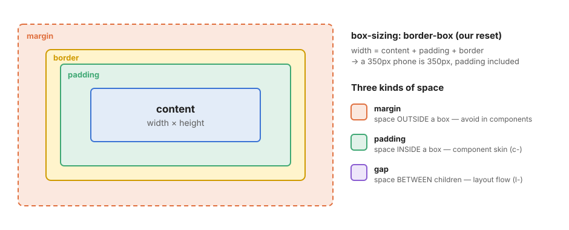
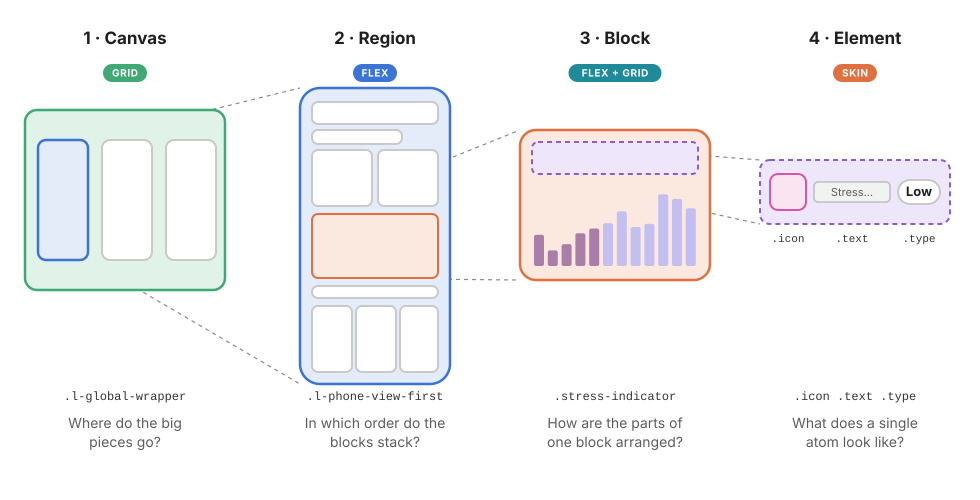
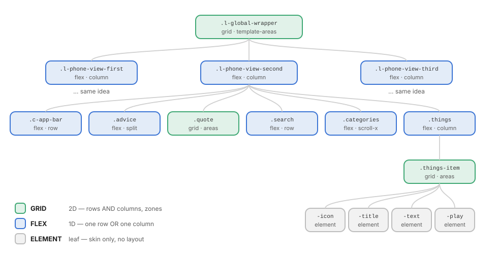
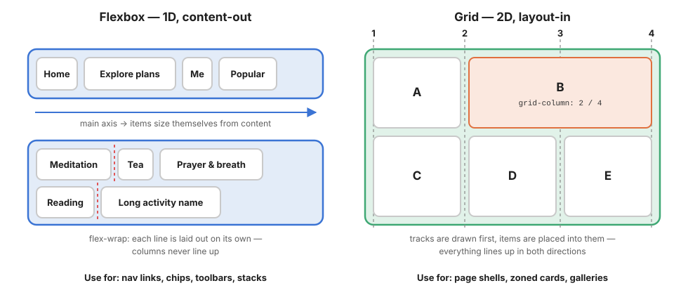
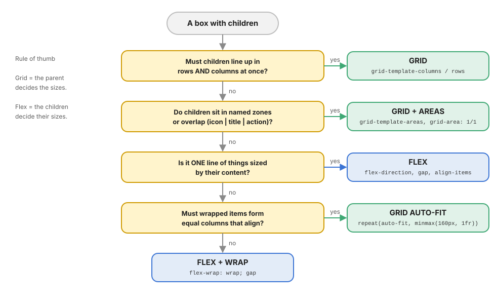

# 00 · The mental model: see boxes, not pixels

> Before writing a single selector, you must be able to answer three questions for **every** rectangle on the mockup:
> 1. **What are its children?** (decomposition)
> 2. **How do they flow?** (Grid or Flex)
> 3. **Who owns which space?** (the parent's `gap`, the box's `padding`, never a child's `margin`)

← [Back to index](README.md) · Next → [01 · Architecture](01-architecture.md)

---

## 1. Everything is a box

The browser does not see "a card with a nice shadow". It sees a rectangle made of four layers: **content**, **padding**, **border** and **margin**.



Because [`base/_reset.scss`](../src/scss/base/_reset.scss) applies `box-sizing: border-box` to every element, **the width you write is the width you get**, padding and border included. A `350px` phone is 350px wide, period. (More in [05 · Base](05-base.md#3-box-sizing-the-rule-that-makes-sizes-add-up).)

### The three kinds of space

This is the single most important habit in this whole guide:

| Space | Lives | Owned by | Use it for |
| ----- | ----- | -------- | ---------- |
| `padding` | **inside** a box, between its border and its content | the box itself (`c-`) | breathing room of a card, a button, a screen |
| `gap` | **between** the children of a flex/grid container | the parent (`l-` or the block that lays out its parts) | the rhythm of a list, a stack, a toolbar |
| `margin` | **outside** a box, pushing its neighbours | *nobody, ideally* | rare optical tweaks, never on a component root |

```text
       ┌──────────── parent (display: flex; gap: 16px; padding: 24px) ────────────┐
       │ ░░░░░░░░░░░░░░░░░░░░░░░ padding (inside the parent) ░░░░░░░░░░░░░░░░░░░░░ │
       │ ░ ┌────────────┐       ┌────────────┐       ┌────────────┐            ░ │
       │ ░ │  child A   │◄─gap─►│  child B   │◄─gap─►│  child C   │            ░ │
       │ ░ └────────────┘       └────────────┘       └────────────┘            ░ │
       │ ░░░░░░░░░░░░░░░░░░░░░░░░░░░░░░░░░░░░░░░░░░░░░░░░░░░░░░░░░░░░░░░░░░░░░░ │
       └──────────────────────────────────────────────────────────────────────────┘
          children have NO margin → they can be reordered, removed, reused anywhere
```

> **Why ban margins on components?** A margin is a decision about the *neighbourhood*, but a component cannot know its neighbourhood. Put `margin-bottom: 16px` on a card and it looks wrong as the last item of a list, in a grid, in a scroller, in a modal. Put `gap: 16px` on the parent and every child is spaced correctly, wherever it lands.

---

## 2. The squint test

Open the mockup, step back and **blur your eyes**. Details disappear; only big masses of colour and whitespace remain. Those masses are your **regions**. Then un-blur a little: the regions break into **blocks**. Then look closely: each block breaks into **elements**.

Do this with a pen on a printed screenshot (or rectangles in any drawing tool) before opening your editor. Five minutes of drawing saves an hour of fighting CSS.

```text
  squint hard          squint a little              look closely
  ┌───┬───┬───┐        ┌───┬───┬───┐                ┌──────────────────────┐
  │   │   │   │        │▀▀▀│▀▀▀│▀▀▀│                │ [🧠] Mind Detox   (▶) │
  │   │   │   │   →    │▄▄▄│▀▀▀│▄▄▄│        →       │      Turn off all…    │
  │   │   │   │        │▀▀▀│▄▄▄│▀▀▀│                └──────────────────────┘
  └───┴───┴───┘        └───┴───┴───┘                 icon · title · text · play
   3 regions            ~6 blocks each                4 elements in 1 block
```

---

## 3. The four levels of decomposition

Every interface, from a landing page to a dashboard, decomposes into the same four levels. Each level asks a different question and usually gets a different tool.



| Level | Question it answers | Typical tool | Class family | In this project |
| ----- | ------------------- | ------------ | ------------ | --------------- |
| **1 · Canvas** | Where do the big pieces go? | **Grid** + named areas | `l-` | `.l-global-wrapper` |
| **2 · Region** | In which order do the blocks stack? | **Flex** column + `gap` | `l-` (+ `c-` for its skin) | `.l-phone-view-first` + `.c-phone-view-first` |
| **3 · Block** | How are the parts of one block arranged? | **Flex** row, or **Grid** with areas | internal to a `c-` | `.stress-indicator`, `.things-item` |
| **4 · Element** | What does a single atom look like? | no layout, only **skin** | element of a block | `.things-item-icon`, `.hello-bell` |

Rules of thumb:

- **Levels 1–2 are layout.** They decide geometry and flow and have (almost) no visual identity. They become `l-` classes.
- **Levels 3–4 are components.** They have a visual identity (colours, radii, type) and lay out their own parts. They become `c-` classes or the internal blocks of a `c-` class.
- **A box can be a child at one level and a parent at the next.** `.things` is a block of the region *and* the flex container of its items. Think in parent/child pairs, not absolute levels.

---

## 4. The box tree

The output of decomposition is a **box tree**: an indented outline where every node says *which display mode it uses*. This tree *is* your HTML skeleton and your SCSS outline.



Write it in plain text first. Here is screen 1, exactly as it is coded in [`index.html`](../index.html) and [`_phone-view-first.scss`](../src/scss/components/_phone-view-first.scss):

```text
.l-global-wrapper                                     GRID   · 5 cols × 3 rows · named areas
└── .c-phone-view .l-phone-view-first .c-phone-view-first   FLEX column · gap $space-md
    ├── .hello                                        FLEX row · split (space-between)
    │   ├── .hello-text                               element
    │   └── .hello-bell                               FLEX center · position: relative
    │       ├── .badge                                position: absolute (decoration)
    │       └── .icon                                 element
    ├── .select-text                                  element (text)
    ├── .select-box                                   FLEX row · split
    │   ├── .select-box-1                             card
    │   │   ├── .avatar                               element
    │   │   └── .footer                               FLEX row · space-around
    │   └── .select-box-2                             (same as -1, other colours)
    ├── .stress-indicator                             card · block flow
    │   ├── .header                                   FLEX row · .text { flex: 1 }
    │   │   ├── .icon  ├── .text  └── .type           elements (.type is a pill)
    │   └── .chart                                    position: relative (SVG wave ::before)
    │       └── .chart-bars                           FLEX row · align-items: flex-end (bar-chart mixin)
    ├── .links                                        FLEX row · split
    └── .footer-boxes                                 FLEX row · scroller (scroll-x) · flex: 1
        └── .footer-boxes-1/2/3                       FLEX column
            ├── .title  ├── .count  └── .illustration elements
```

How to build one:

1. Start from the outermost box and write one line per box.
2. Next to each box, write **one word for its display**: `GRID`, `FLEX row`, `FLEX column`, `scroller`, `element`.
3. Indent its children below it. Stop when a box has no visual children (text, icon, image).
4. Mark the boxes that repeat (`-1/2/3`, list items). They will share one rule plus modifiers.
5. Mark the boxes that appear on **several screens** (here the app bar and the icon). They become standalone `c-` components with their own file.

---

## 5. Grid vs Flex

Both are layout engines. They differ in **direction** and in **who decides the sizes**.



| | **Flexbox** | **Grid** |
| - | ----------- | -------- |
| Dimensions | **1D**: one row *or* one column | **2D**: rows *and* columns at the same time |
| Sizing direction | **content-out**: children size themselves, the container distributes leftovers | **layout-in**: the container draws tracks, children are placed into them |
| Wrapping | each wrapped line is independent, so columns don't align | items always align on both axes |
| Overlap | not possible without `position` | trivial: two items in the same cell |
| Best for | nav links, chips, toolbars, stacks, button groups, a media object's text | page shells, zoned cards, galleries, forms with labels, dashboards |
| In this project | `.l-phone-view-*`, `.c-app-bar`, `.advice`, `.search`, `.categories` | `.l-global-wrapper`, `.quote`, `.things-item`, `.stats` |

The one-liner to remember:

> **Grid: the parent decides the sizes. Flex: the children decide their sizes.**

---

## 6. The decision tree

When you are not sure, walk down this tree for each box that has children.



The same tree, as questions you can ask out loud:

| # | Question | If yes → | Typical code |
| - | -------- | -------- | ------------ |
| 1 | Must children line up in **rows and columns at once**? | **Grid** | `grid-template-columns: …; grid-template-rows: …;` |
| 2 | Do children sit in **named zones**, or must they **overlap**? | **Grid + areas** | `grid-template-areas: "icon title play" "icon text play";` |
| 3 | Is it **one line** of things sized by their content? | **Flex** | `display: flex; gap: …; align-items: center;` |
| 4 | Must **wrapped** items form **equal columns** that align? | **Grid auto-fit** | `repeat(auto-fit, minmax(160px, 1fr))` |
| 5 | Otherwise (wrapping items of different widths, like tags) | **Flex + wrap** | `display: flex; flex-wrap: wrap; gap: …;` |

> **There is no wrong answer between "flex column + gap" and "grid + row-gap"** for a simple vertical stack. This project uses flex columns for the screens because `flex: 1` makes "let the last block take the rest" trivial (see [06 · Layout](06-layout.md#6-flex-sizing-flex-1-and-the-min-size-trap)).

---

## 7. Worked example: one block, start to finish

Take the "Things you can do" item from screen 2:

```text
 ┌──────────────────────────────────────────────┐
 │ ┌──────┐  Mind Detox                      ▶  │
 │ │  🧠  │  Turn off all screens for 10 min ( ) │
 │ └──────┘                                     │
 └──────────────────────────────────────────────┘
```

1. **Squint**: one rounded white rectangle. It is a **block**.
2. **Children**: an icon tile, a title, a description, a play button. Four **elements**.
3. **Relationships**: the icon spans both lines on the left, the play button spans both lines on the right, title and text stack in the middle. Two lines *and* three columns, with **zones** → question 2 of the tree → **Grid + areas**.
4. **Sizes**: icon and button are as wide as their content (`auto`), the middle takes the rest (`1fr`).
5. **Write it**:

```scss
.things-item {
  display: grid;
  grid-template-columns: auto 1fr auto;
  grid-template-areas:
    "icon title play"
    "icon text  play";
  column-gap: $space-sm;
  padding: $space-sm;               // inside: owned by the block
}
.things-item-icon  { grid-area: icon; }
.things-item-title { grid-area: title; align-self: end; }
.things-item-text  { grid-area: text;  align-self: start; }
.things-item-play  { grid-area: play; }
```

6. **Space ownership**: `padding` lives on the item (its own breathing room), the vertical space *between* items is the list's `gap: $space-sm`. The item has **no margin**.

The real code is in [`_phone-view-second.scss`](../src/scss/components/_phone-view-second.scss), and the full anatomy is in [07 · Components](07-components.md).

---

## 8. Anti-patterns to unlearn

| ✗ Anti-pattern | Why it hurts | ✓ Do instead |
| -------------- | ------------ | ------------ |
| Coding top-to-bottom from the mockup without a tree | You discover the structure halfway and rewrite everything | Draw the box tree first (section 4) |
| `margin-bottom` on every card | Last item gets extra space; breaks in grids and scrollers | `gap` on the parent |
| `position: absolute` to place blocks | Removes them from the flow; breaks on every screen size | Grid areas, or flex + alignment |
| Fixed `height` on content blocks | Text overflows when it changes or is translated | `min-height`, or let content decide; `flex: 1` to fill |
| Using `float` or `inline-block` for layout | Legacy hacks with whitespace bugs and clearing | Flex or Grid |
| Wrapping everything in extra `<div>`s "just in case" | Deeper trees, deeper selectors, harder to maintain | One box per meaningful rectangle; use `gap` and `::before` |
| Choosing Grid or Flex by habit | Fighting the engine: equal columns in flex-wrap, content sizing in grid | Walk the decision tree (section 6) |
| Styling the region and its content in one class | Can't move the content to another region without copying CSS | Split `l-` (where/flow) from `c-` (look/content). See [08](08-layout-vs-components.md) |

---

## ✅ Checklist: "I have decomposed the mockup"

- [ ] I can point at every rectangle and name its level (canvas / region / block / element).
- [ ] I have a written box tree with a display mode next to every box that has children.
- [ ] Every container has a decided `gap`; no child needs a margin.
- [ ] Repeated boxes are identified (they will share one rule + modifiers).
- [ ] Boxes shared across screens are identified (they will become standalone `c-` files).
- [ ] I know which boxes are layout (`l-`) and which are components (`c-`).

Next → [01 · Architecture](01-architecture.md): where each of those boxes will live in the file system.
