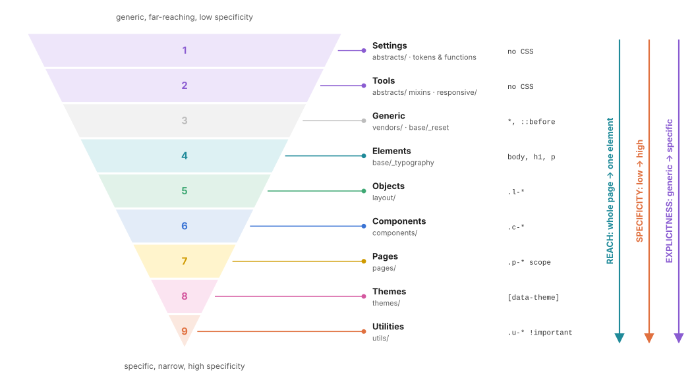
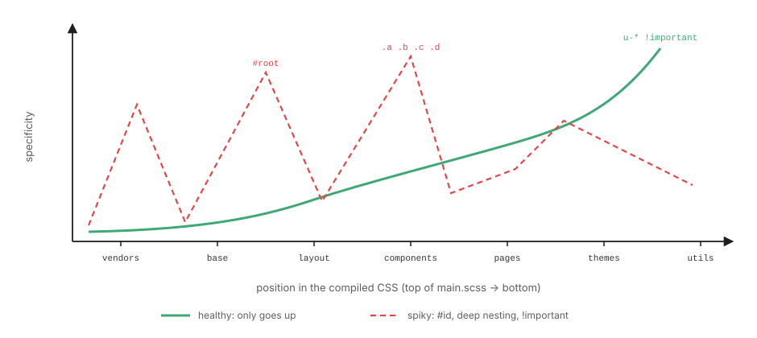
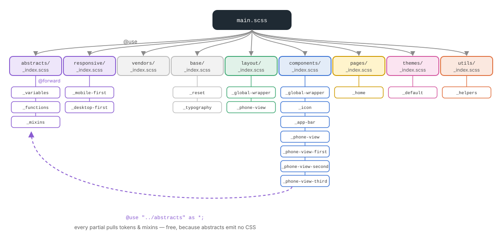

# 01 · Architecture: 7-1 pattern × ITCSS

> **7-1** answers *"in which folder does this rule live?"*
> **ITCSS** answers *"in which order is it written to the final CSS?"*
> Combined, they guarantee that **specificity only goes up** as you read the compiled file, so later, more specific layers win without hacks.

← [00 · Mental model](00-mental-model.md) · [Index](README.md) · Next → [02 · Abstracts](02-abstracts.md)

---

## 1. Two ideas, one structure

**The 7-1 pattern** (Hugo Giraudel) splits a Sass code base into thematic folders, each with an `_index.scss`, all pulled into a single `main.scss`. This project uses **9 folders**: the classic 7 plus `responsive/` (breakpoint tools) and `layout/` and `components/` kept distinct.

**ITCSS** (*Inverted Triangle CSS*, Harry Roberts) orders those layers from the most **generic, far-reaching and low-specificity** rules to the most **explicit, narrow and high-specificity** ones.



Read the triangle top to bottom. Three things change together:

| Axis | Top of the triangle | Bottom of the triangle |
| ---- | ------------------- | ---------------------- |
| **Reach**: how many elements a rule touches | the whole page (`*`, `body`) | one element (`.u-mt-0`) |
| **Specificity**: selector weight | `(0,0,0)`–`(0,0,1)` | `(0,1,0)` + `!important` |
| **Explicitness**: how intentional | "all paragraphs are muted" | "this exact heading has no top margin" |

---

## 2. The nine layers at a glance

| # | Folder | ITCSS layer | Emits CSS? | Selectors allowed | Prefix | Example |
| - | ------ | ----------- | ---------- | ----------------- | ------ | ------- |
| 1 | [`abstracts/`](../src/scss/abstracts/) | Settings + Tools | **No** | none (vars, functions, mixins) | `$`, `@mixin`, `@function` | `$space-md`, `@mixin circle` |
| 2 | [`responsive/`](../src/scss/responsive/) | Tools | **No** | none (mixins only) | `@mixin` | `@include desktop-first(laptop)` |
| 3 | [`vendors/`](../src/scss/vendors/) | Generic | Yes | whatever the library ships | none | normalize.css |
| 4 | [`base/`](../src/scss/base/) | Generic + Elements | Yes | `*`, element selectors, attribute selectors | none | `*, ::before`, `body`, `h1`, `p` |
| 5 | [`layout/`](../src/scss/layout/) | Objects | Yes | one class | `l-` | `.l-global-wrapper` |
| 6 | [`components/`](../src/scss/components/) | Components | Yes | a class + nested parts | `c-` | `.c-app-bar`, `.c-phone-view-second .things-item` |
| 7 | [`pages/`](../src/scss/pages/) | *(scope)* | Yes | page hook + component | `p-` *(proposed)* | `.p-home .c-card` |
| 8 | [`themes/`](../src/scss/themes/) | *(theme)* | Yes | `:root`, theme hooks | none | `:root { --surface: … }` |
| 9 | [`utils/`](../src/scss/utils/) | Utilities / Trumps | Yes | one class, one job | `u-` | `.u-mt-0 { margin-top: 0 !important; }` |

> **Why are layers 1 and 2 first if they emit nothing?** Because everything below *uses* them. Settings and tools must exist before any rule can reference `$space-md` or `@include circle(…)`. Since they produce 0 bytes, their position costs nothing (see [02 · Abstracts](02-abstracts.md#1-the-golden-rule-abstracts-emit-zero-css)).

---

## 3. `main.scss`: the only entry point

[`src/scss/main.scss`](../src/scss/main.scss) contains **nothing but `@use` statements**, numbered in ITCSS order. It is the table of contents of your CSS:

```scss
// 1. Settings & Tools — no CSS output
@use "abstracts";
// 2. Responsive — mobile-first & desktop-first mixins, no CSS output
@use "responsive";
// 3. Vendors
@use "vendors";
// 4. Generic & Elements
@use "base";
// 5. Objects — layout (l-xxx)
@use "layout";
// 6. Components (c-xxx)
@use "components";
// 7. Page-scoped
@use "pages";
// 8. Themes
@use "themes";
// 9. Utilities (u-xxx) — last so they always win
@use "utils";
```

Rules for `main.scss`:

- **Never write a selector in it.** If you feel the need, the rule belongs in one of the nine folders.
- **Never reorder it.** The order *is* the architecture.
- **Only `@use` folders**, not individual files. Each folder's `_index.scss` decides what it exposes.

---

## 4. Specificity only goes up

If the order is respected, plotting the specificity of every selector against its position in the compiled file gives a curve that **only rises**. A rule written later and with more weight wins, and that is exactly the rule you meant to win.



Spikes are bugs waiting to happen. Each one forces every later rule to be *even heavier* to win, which creates new spikes:

| Spike | Specificity | Why it appears | Fix |
| ----- | ----------- | -------------- | --- |
| `#root .title` | `(1,1,0)` | styling by ID | use a class; IDs are for anchors and `<label for>` |
| `.a .b .c .d .e` | `(0,5,0)` | nesting mirrors the DOM | max **3 levels**; name the element (`.things-item-icon`) |
| `color: red !important` in a component | ∞ | "it didn't work, so…" | find the rule that wins and fix the order or the weight |
| `div.card` | `(0,1,1)` | qualifying a class with a tag | `.card` alone |

**Budget per layer** (what a "normal" selector looks like):

```text
base/        p, h1, *, [role="list"]                          (0,0,1) – (0,1,1)
layout/      .l-phone-view-first                              (0,1,0)
components/  .c-app-bar-back:hover                            (0,2,0)
             .c-phone-view-second .things-item-play:hover     (0,3,0)   ← the ceiling
pages/       .p-home .c-card                                  (0,2,0)
utils/       .u-mt-0 { … !important }                         (0,1,0) + importance
```

---

## 5. The Sass module system

The module system (`@use` / `@forward`) arrived in Dart Sass 1.23; `@import` has been deprecated since Dart Sass 1.80 and will be removed in Sass 3.0. This project uses the **module system** exclusively.



### `@use` vs `@forward`

| Directive | Where | What it does | Example |
| --------- | ----- | ------------ | ------- |
| `@use "x"` | in any file that **consumes** something | loads module `x` **once**, gives access to its members under the namespace `x.` (or none with `as *`) and **emits its CSS once** | `@use "../abstracts" as *;` |
| `@forward "x"` | in an `_index.scss` (a **barrel**) | re-exports `x`'s members to whoever `@use`s the folder, without using them itself | `@forward "variables";` |

```text
components/_app-bar.scss
   @use "../abstracts" as *;        ── loads abstracts/_index.scss
                                         ├── @forward "variables"   → $space-md, $color-ink, …
                                         ├── @forward "mixins"      → circle(), focus-ring(), …
                                         └── @forward "functions"   → rem(), svg-url()
   .c-app-bar-back { @include circle($size-control-lg + $space-sm); }
```

### Key facts that make the architecture work

- **A module is evaluated once**, no matter how many files `@use` it. Every partial can `@use "../abstracts" as *;` for free.
- **`as *`** drops the namespace (`$space-md` instead of `abstracts.$space-md`). Use it for your own abstracts (short, project-wide names). Keep namespaces for third-party modules (`@use "sass:map";` → `map.get(…)`).
- **`_index.scss`** is loaded automatically when you `@use` a folder: `@use "layout"` = `@use "layout/index"`.
- **Private members**: a variable, mixin or function whose name starts with `-` or `_` is invisible outside its file. This project uses it for internal data: `$-breakpoints`, `$-svg-escapes`, `$-stress-bars`.
- **Order inside an `_index.scss` is order in the CSS.** In [`components/_index.scss`](../src/scss/components/_index.scss), shared components (`icon`, `app-bar`, `phone-view`) come before screen-specific ones.

### Each partial declares its own dependencies

```scss
// layout/_global-wrapper.scss
@use "../abstracts" as *;    // tokens: $phone-width, $space-lg…
@use "../responsive" as *;   // mixins: desktop-first()

.l-global-wrapper { … }
```

Never rely on "it was imported before me in `main.scss`". With `@use`, a file sees **only** what it loads itself. This is a feature: dependencies are explicit and every file can be read in isolation.

---

## 6. Naming conventions

The project uses **prefixed, hyphenated BEM**: a namespace prefix plus *block*, `-element` and `--modifier`.

```text
 c-app-bar          block           (prefixed: it is a standalone component)
 c-app-bar-back     element         (single hyphen: part of the block)
 c-app-bar--divided modifier        (double hyphen: a variant of the block)

 things-item        internal block  (unprefixed: only exists inside .c-phone-view-second)
 things-item-icon   element
 things-item--detox modifier
```

| Kind | Pattern | Example | Where it is defined |
| ---- | ------- | ------- | ------------------- |
| Layout object | `l-{name}` | `l-phone-view-first` | `layout/_{name}.scss` |
| Component | `c-{block}` | `c-app-bar` | `components/_{block}.scss` |
| Component element | `c-{block}-{element}` | `c-app-bar-title` | same file, nested with `&-title` |
| Component modifier | `c-{block}--{modifier}` | `c-app-bar--divided` | same file, nested with `&--divided` |
| Internal block | `{block}` (no prefix) | `things-item` | inside its owner `c-` file, nested under it |
| Page hook *(proposed)* | `p-{page}` | `p-home` | `pages/_{page}.scss` |
| Utility | `u-{property}-{value}` | `u-mt-0`, `u-text-center` | `utils/_helpers.scss` |
| Token | `$category-variant` | `$space-md`, `$color-teal-dark` | `abstracts/_variables.scss` |
| Private Sass member | `$-name` | `$-breakpoints` | the file that uses it |

> **Prefixed or not?** A block gets the `c-` prefix and its own file as soon as it is used in **two places** (or is clearly meant to be reused). Until then, it can live as an unprefixed internal block, scoped under its owner (`.c-phone-view-second .things-item`), so its short name cannot leak or collide. See [07 · Components](07-components.md#7-internal-blocks-vs-standalone-components).

---

## 7. Adding a new partial: step by step

Say you need a reusable `c-badge` component.

1. **Pick the folder** with the table in section 2. It has a skin, so `components/`.
2. **Create the file** `components/_badge.scss`, with an underscore (a partial, never compiled alone).
3. **Declare its dependencies** at the top:
   ```scss
   @use "../abstracts" as *;
   ```
4. **Write one root class** matching the file name:
   ```scss
   .c-badge {
     @include pill($color-pink);
     font-weight: $font-weight-bold;
   }
   ```
5. **Register it** in the folder's barrel, at the right position (shared components first):
   ```scss
   // components/_index.scss
   @forward "global-wrapper";
   @forward "icon";
   @forward "badge";      // ← new
   @forward "app-bar";
   …
   ```
6. **Do not touch `main.scss`**: it already loads the folder.
7. **Build** (`npx vite build`) to catch undefined variables or mixins immediately.

---

## ✅ Checklist: "my architecture is healthy"

- [ ] `main.scss` only contains `@use` lines, in the 9-layer order.
- [ ] Every folder has an `_index.scss` that only contains `@forward` lines.
- [ ] Every partial `@use`s what it needs (`../abstracts`, `../responsive`) and nothing more.
- [ ] No `@import` anywhere.
- [ ] Every class has a prefix that matches its folder (`l-` in layout, `c-` in components, `u-` in utils).
- [ ] No ID selectors, no tag-qualified classes, no selector deeper than 3 levels.
- [ ] `!important` appears only in `utils/`.
- [ ] Private data uses `$-name`.

Next → [02 · Abstracts](02-abstracts.md): the tokens and tools every other layer depends on.
