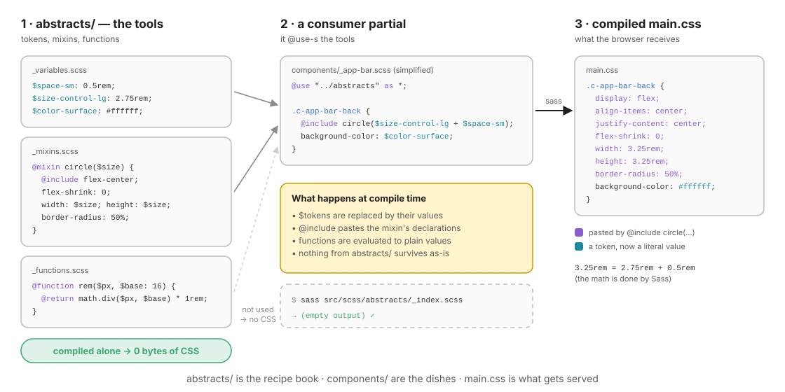
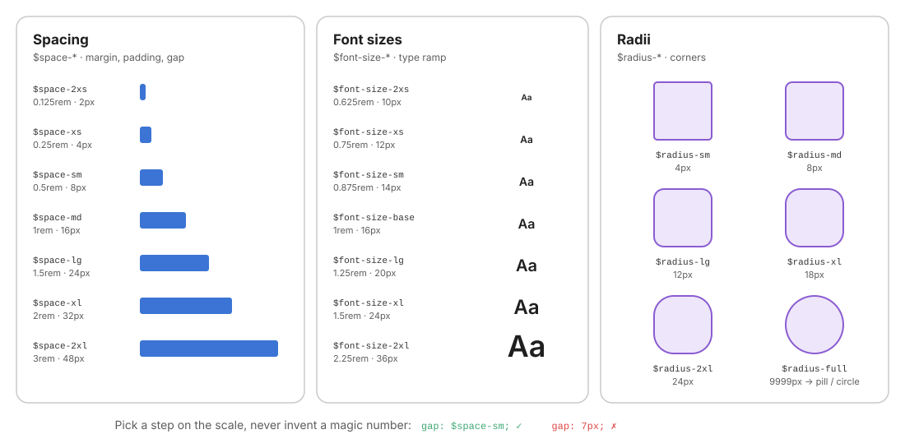
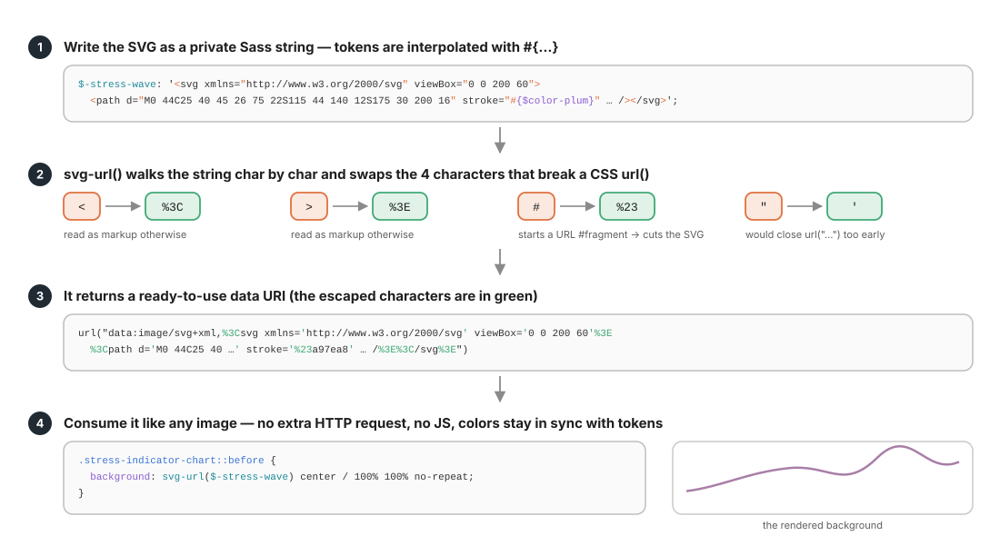
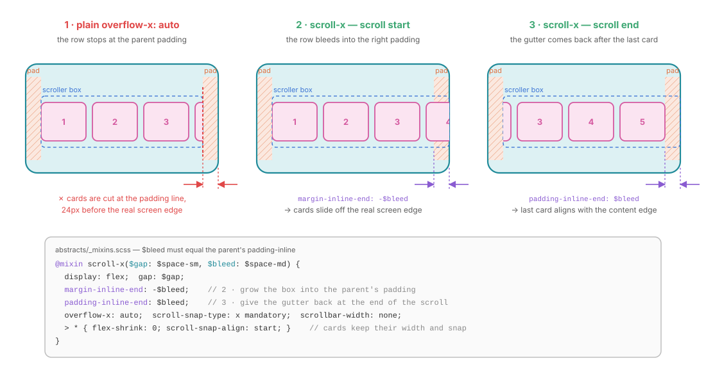
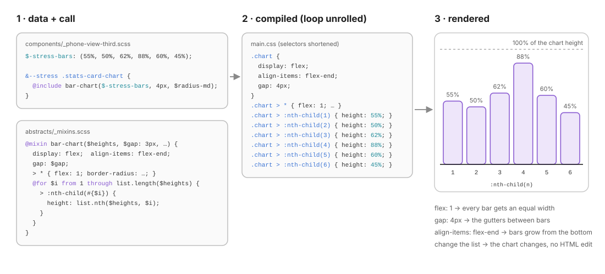

# 02 · Abstracts: tokens, functions and mixins

> `abstracts/` is the **toolbox**: design decisions (tokens), calculators (functions) and reusable declaration blocks (mixins).
> It is imported by every other layer and **emits zero bytes of CSS** on its own.

← [01 · Architecture](01-architecture.md) · [Index](README.md) · Next → [03 · Responsive](03-responsive.md)

```text
abstracts/
├── _index.scss       @forward "variables"; @forward "mixins"; @forward "functions";
├── _variables.scss   tokens:     $color-*, $font-*, $space-*, $radius-*, sizes, motion, z-index
├── _functions.scss   functions:  rem(), svg-url()
└── _mixins.scss      mixins:     flex-center, stack, circle, pill, card, scroll-x, bar-chart, …
```

---

## 1. The golden rule: abstracts emit zero CSS

A file in `abstracts/` may only contain **variables, functions, mixins and placeholder-free logic**. Never a selector. That way:

- any partial can `@use "../abstracts" as *;` at **no cost**,
- a mixin that nobody includes produces **nothing** in the final file,
- the folder can be shared between projects without dragging styles along.



At compile time:

| Source | Becomes |
| ------ | ------- |
| `$space-sm` | its value, `0.5rem`, inlined where it is used |
| `@include circle(3.25rem)` | the mixin's declarations, pasted into the calling rule |
| `rem(24)` | the computed value `1.5rem` |
| an unused mixin | nothing at all |

> **Test**: compile `abstracts/_index.scss` alone. The output must be empty. If it is not, a selector has leaked into the toolbox.

---

## 2. Tokens (`_variables.scss`)

A **token** is a named design decision. The mockup says "this grey", "this gap", "this corner"; the token gives it a name so the decision is made **once** and reused everywhere.



### The token families in this project

| Family | Naming | Values | Used for |
| ------ | ------ | ------ | -------- |
| **Brand colours** | `$color-{role}` | `primary`, `secondary`, `bg`, `surface`, `text`, `muted`, `border` | semantic roles reused across any screen |
| **Palette** | `$color-{hue}[-strong]` | `pink`, `teal-dark`, `lavender`, `violet`, `plum`, `sky`, `mint`, `lemon`, `ink`… | the mockup's illustration colours |
| **Overlays** | `$color-overlay-{light\|dark}` | `rgba(…)` | translucent fills that work on any background |
| **Font families** | `$font-family-{base\|mono}` | `"Wotfard", sans-serif` | |
| **Font weights** | `$font-weight-{name}` | `300 / 400 / 700` | |
| **Font sizes** | `$font-size-{t-shirt}` | `2xs .625` → `2xl 2.25rem` | the type ramp |
| **Line heights** | `$line-height-{base\|tight}` | `1.5 / 1.2` | body / headings |
| **Spacing** | `$space-{t-shirt}` | `2xs .125` → `2xl 3rem` | `padding`, `gap`, rare `margin` |
| **Radii** | `$radius-{t-shirt}` | `4px` → `24px`, `full: 9999px` | corners, pills, circles |
| **Sizes** | `$phone-*`, `$size-control-{sm\|md\|lg}` | `350×700px`, `1.75 / 2.25 / 2.75rem` | fixed canvases, touch targets |
| **Motion** | `$transition-base` | `150ms ease-out` | every transition |
| **Layers** | `$z-{name}` | `1 / 100 / 1000 / 1100` | stacking order |

### Rules for tokens

1. **Name by role or by scale, never by value.** `$space-md`, not `$space-16`. If the value changes, the name stays true.
2. **Scales are t-shirt sizes** (`2xs xs sm md lg xl 2xl`) so you can always insert a step later.
3. **Pick a step, never invent a number.** `gap: $space-sm;` ✓ · `gap: 7px;` ✗. If the mockup really needs 7px, the scale is missing a step: add it to the scale, not to the component.
4. **Derive, don't duplicate.** Compose tokens with math when a size depends on others:
   ```scss
   // components/_app-bar.scss — the back button is a large control plus a little extra
   @include circle($size-control-lg + $space-sm);                       // 3.25rem
   // the title reserves the same width on the right so it stays optically centred
   padding-inline-end: $size-control-lg + $space-sm + $space-md;
   ```
5. **Private tokens stay private.** Data that only one file needs (chart heights, an inline SVG) lives in that file as `$-name`:
   ```scss
   // components/_phone-view-third.scss
   $-stress-bars: (55%, 50%, 62%, 88%, 60%, 45%);
   ```

---

## 3. Functions (`_functions.scss`)

A function **returns a value**; it never outputs declarations.

### `rem($px, $base: 16)`

Converts design-tool pixels to `rem` so text scales with the user's font-size preference:

```scss
@function rem($px, $base: 16) {
  @return math.div($px, $base) * 1rem;
}

// usage
font-size: rem(18);   // → 1.125rem
```

### `svg-url($svg)`: inline SVG as a background, with tokens

The mockup's stress wave and sleep chart are decorative drawings. Instead of image files, they are **Sass strings** that can interpolate tokens (`#{$color-plum}`), turned into a data URI by `svg-url()`.



```scss
$-svg-escapes: ("<": "%3C", ">": "%3E", "#": "%23", '"': "'");

@function svg-url($svg) {
  $encoded: "";
  @for $i from 1 through string.length($svg) {
    $char: string.slice($svg, $i, $i);
    @if map.has-key($-svg-escapes, $char) {
      $char: map.get($-svg-escapes, $char);
    }
    $encoded: $encoded + $char;
  }
  @return url("data:image/svg+xml,#{$encoded}");
}
```

Why only four characters? Those are the only ones that **break a `url()`** in practice: `<` and `>` are read as markup by some parsers, `#` starts a URL fragment and silently truncates the SVG, and `"` would close the `url("…")` string early.

Used in [`_phone-view-first.scss`](../src/scss/components/_phone-view-first.scss) (`.stress-indicator .chart::before`) and [`_phone-view-third.scss`](../src/scss/components/_phone-view-third.scss) (`.stats-card--sleep .stats-card-chart`):

```scss
& .chart {
  position: relative;
  …
  &::before {
    content: "";
    position: absolute;
    inset: 0 0 $space-sm;
    background: svg-url($-stress-wave) center / 100% 100% no-repeat;
  }
}
```

> **When to use it**: small decorative shapes that should follow your tokens. **When not to**: meaningful images (use ``), or icons that need `currentColor` (use an inline `<svg>` with `.c-icon`, as the app bar does).

---

## 4. The mixin catalog (`_mixins.scss`)

A mixin **pastes declarations** (and possibly nested selectors) into the rule that includes it. Here is every mixin in the project:

| Mixin | Signature | Outputs | Used by |
| ----- | --------- | ------- | ------- |
| `flex-center` | `()` | `display: flex; align-items: center; justify-content: center;` | icons, bells, `circle()` |
| `stack` | `($gap: $space-md)` | flex column + `gap` | *(available, unused so far: costs 0 bytes)* |
| `sr-only` | `()` | the visually-hidden pattern (1px clip) | `.u-sr-only` |
| `circle` | `($size)` | `flex-center` + `flex-shrink: 0` + square size + `border-radius: 50%` | `.c-app-bar-back`, `.dates-option`, nav buttons |
| `button-reset` | `()` | removes native button chrome; `font: inherit; color: inherit; cursor: pointer` | every `<button>` |
| `focus-ring` | `($offset: 2px)` | **a nested selector**: `&:focus-visible { outline: 2px solid $color-teal-dark; … }` | every interactive element |
| `pill` | `($background: $color-surface)` | inline-flex, small padding, `radius-full`, `font-size-xs`, `nowrap` | tags, categories, chips |
| `card` | `($background, $radius: $radius-2xl)` | `border-radius` + `background-color` | `.stress-indicator`, `.things-item`, `.task`… |
| `scroll-x` | `($gap: $space-sm, $bleed: $space-md)` | horizontal snap scroller that bleeds into the parent padding | `.categories`, `.footer-boxes`, `.quiz-suggestions` |
| `bar-chart` | `($heights, $gap: 3px, $radius: $radius-sm)` | flex row aligned at the bottom + one `:nth-child` height per list item | screen 1 and screen 3 charts |
| `line-clamp` | `($lines)` | multi-line ellipsis | `.things-item-text` |
| `reduced-motion` | `()` + `@content` | `@media (prefers-reduced-motion: reduce) { … }` | every component with a transition |

### Three kinds of mixins

```text
 1. Declaration bundle        2. Selector generator          3. Wrapper (@content)
 ─────────────────────        ──────────────────────         ─────────────────────
 @mixin card($bg, $r) {       @mixin focus-ring($o: 2px) {   @mixin reduced-motion {
   border-radius: $r;           &:focus-visible {              @media (prefers-
   background-color: $bg;         outline: 2px solid …;          reduced-motion: reduce) {
 }                                outline-offset: $o;              @content;
                                }                                }
                              }                                }
 → pastes declarations        → adds a state to the caller   → wraps the caller's block
```

---

## 5. Deep dive: `scroll-x` and the bleed trick

A horizontal list inside a padded screen has a problem: `overflow-x: auto` clips at the **padding edge**, so cards are cut 16px before the real screen edge. It looks broken.



```scss
@mixin scroll-x($gap: $space-sm, $bleed: $space-md) {
  display: flex;
  gap: $gap;
  margin-inline-end: -$bleed;      // 1. grow the box INTO the parent's right padding
  padding-inline-end: $bleed;      // 2. give the gutter back at the end of the scroll
  overflow-x: auto;
  overscroll-behavior-x: contain;  // 3. don't scroll the page when the list hits its end
  scroll-snap-type: x mandatory;   // 4. cards snap into place
  scrollbar-width: none;           // 5. hide the bar (Firefox) …
  &::-webkit-scrollbar { display: none; }  // … and WebKit

  > * {
    flex-shrink: 0;                // 6. cards keep their width instead of squashing
    scroll-snap-align: start;
  }
}
```

> **Contract**: `$bleed` must equal the parent's `padding-inline`. The screens use `padding-inline: $space-md`, so every call passes `$space-md`. This is the one negative margin allowed in the project, and it is encapsulated in a mixin with a documented reason.

---

## 6. Deep dive: `bar-chart` and Sass loops

The stress charts are a row of bars whose heights come from **data**. Hard-coding 15 `:nth-child` rules by hand is error-prone; a Sass list plus a `@for` loop writes them for you.



```scss
@mixin bar-chart($heights, $gap: 3px, $radius: $radius-sm) {
  display: flex;
  align-items: flex-end;           // bars grow from the bottom
  gap: $gap;

  > * {
    flex: 1;                       // equal widths, whatever the count
    border-radius: $radius $radius 2px 2px;
  }

  @for $i from 1 through list.length($heights) {
    > :nth-child(#{$i}) {
      height: list.nth($heights, $i);
    }
  }
}

// components/_phone-view-third.scss
$-stress-bars: (55%, 50%, 62%, 88%, 60%, 45%);
.stats-card--stress .stats-card-chart {
  @include bar-chart($-stress-bars, 4px, $radius-md);
}
```

The HTML is just six empty `<span>`s. Change the data list and the chart changes; no JS, no inline styles.

---

## 7. Mixin, `@extend`, utility or component?

Four ways to reuse styles. Choose deliberately:

| Need | Tool | Why |
| ---- | ---- | --- |
| The same **group of declarations** in many components, possibly with parameters | **`@mixin`** | explicit, parameterisable, no selector side effects |
| A single property applied **from the HTML** for one-off adjustments | **`u-` utility** | no new CSS needed. See [11 · Utils](11-utils.md) |
| A recurring **visual unit** with its own identity (it has a name in the mockup) | **`c-` component** | it deserves a file, a block name, modifiers |
| Sharing styles between selectors | ~~`@extend`~~ | **avoid**: it rewrites selectors far away in the output, cannot cross `@media`, and silently changes the cascade order |

> **Mixin smell**: a mixin with more than ~4 parameters, or with `@if` branches for each caller, is a component in disguise. Give it a class.

---

## 8. Writing a good mixin

```scss
// ✓ defaults come from tokens → calling with no args gives the design-system look
@mixin pill($background: $color-surface) { … }

// ✓ guard against misuse at compile time
@mixin desktop-first($name) {
  @if not map.has-key($-breakpoints, $name) {
    @error "Unknown desktop-first breakpoint `#{$name}`. Available: #{map.keys($-breakpoints)}.";
  }
  …
}

// ✓ one responsibility: circle() sizes and centres; it does NOT set a colour
@mixin circle($size) { @include flex-center; flex-shrink: 0; width: $size; height: $size; border-radius: 50%; }

// ✗ a mixin that positions its caller (margin, grid-area) breaks the l-/c- contract
@mixin card-in-grid { grid-column: span 2; margin-top: 24px; … }
```

---

## ✅ Checklist: abstracts

- [ ] Compiling `abstracts/` alone produces no CSS.
- [ ] Every colour, space, radius, font size and duration in the code base is a token.
- [ ] Token names describe a role or a scale step, never a value.
- [ ] File-local data uses `$-private` variables.
- [ ] Mixin parameters default to tokens.
- [ ] Mixins with selectors (`&:focus-visible`, `> *`) are documented in a comment.
- [ ] No `@extend`.
- [ ] Mixins never set `margin`, `grid-area` or `position` on their caller (except `scroll-x`'s documented bleed).

Next → [03 · Responsive](03-responsive.md): the other no-output toolbox.
