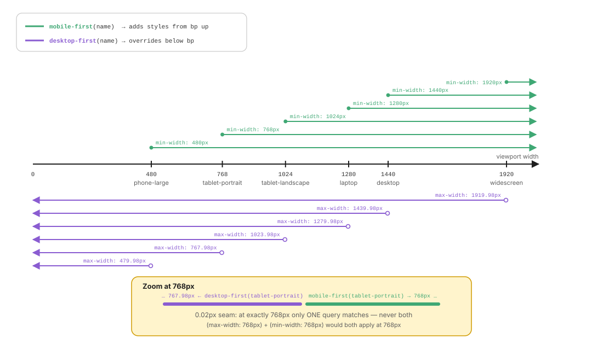
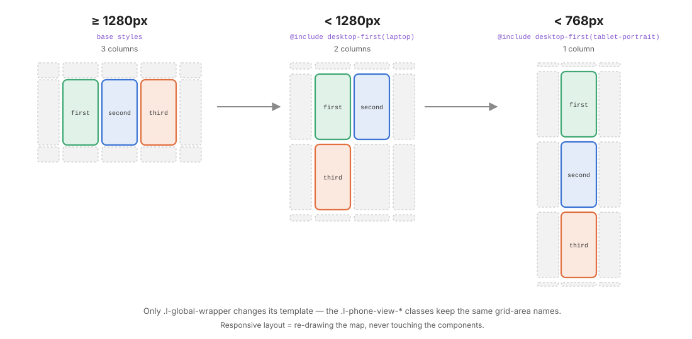

# 03 · Responsive: redraw the map, not the components

> Responsive design is **a layout problem first**. When the screen shrinks, you change *where* boxes go (`grid-template-*`) and *how* they flow, and you leave the components alone.
> `responsive/` provides the tools for that: two breakpoint mixins, **zero CSS output**.

← [02 · Abstracts](02-abstracts.md) · [Index](README.md) · Next → [04 · Vendors](04-vendors.md)

```text
responsive/
├── _index.scss          @forward "mobile-first"; @forward "desktop-first";
├── _mobile-first.scss   @mixin mobile-first($name)   → @media (min-width: bp)
└── _desktop-first.scss  @mixin desktop-first($name)  → @media (max-width: bp - 0.02px)
```

---

## 1. Intrinsic first, breakpoints second

Before reaching for a media query, ask whether the layout can **adapt by itself**. Modern CSS often makes breakpoints unnecessary:

| Technique | Adapts how | Example |
| --------- | ---------- | ------- |
| `repeat(auto-fit, minmax(160px, 1fr))` | as many columns as fit, then they stretch | galleries, card grids |
| `minmax(0, $phone-width)` | a column that shrinks below its ideal size | `.l-global-wrapper` on mobile |
| `flex-wrap: wrap` + `gap` | items wrap onto new lines | tags, chips, button groups |
| `flex: 1` + `min-width: 0` | one item absorbs the remaining space | `.search-input`, `.c-app-bar-title` |
| `clamp(min, preferred, max)` | fluid value between two bounds | `font-size: clamp(1.25rem, 4vw, 2.25rem)` |
| `max-width` + `margin-inline: auto` | content stops growing and centres | readable text columns |
| `aspect-ratio` | keeps proportions while resizing | media, avatars |

Use a breakpoint only when the **structure** must change: 3 columns become 2, a sidebar moves below, an area appears or disappears.

---

## 2. The breakpoint scale

Both mixins share the same six named breakpoints, chosen from real device classes:



| Name | Width | Device class | Typical change |
| ---- | ----- | ------------ | -------------- |
| `phone-large` | 480px | large phones, small phones in landscape | bigger touch targets |
| `tablet-portrait` | 768px | iPad portrait | 1 → 2 columns |
| `tablet-landscape` | 1024px | iPad landscape, small laptops | sidebars appear |
| `laptop` | 1280px | 13"–15" laptops | main desktop target |
| `desktop` | 1440px | Full HD monitors | cap line lengths, add gutters |
| `widescreen` | 1920px | 2K+ / ultra-wide | extra columns, larger canvas |

The maps are **private** (`$-breakpoints`) and each mixin guards against typos at compile time:

```scss
@mixin mobile-first($name) {
  @if not map.has-key($-breakpoints, $name) {
    @error "Unknown mobile-first breakpoint `#{$name}`. Available: #{map.keys($-breakpoints)}.";
  }
  @media (min-width: map.get($-breakpoints, $name)) {
    @content;
  }
}
```

`@include mobile-first(tablet)` fails the build with the list of valid names. A typo can never silently produce a query that never matches.

---

## 3. Mobile-first vs desktop-first

|  | **mobile-first** | **desktop-first** |
| - | ---------------- | ----------------- |
| Base styles target | the **smallest** screen | the **largest** screen |
| Each query… | **adds** styles from the breakpoint **up** | **overrides** styles from the breakpoint **down** |
| Media query | `(min-width: 768px)` | `(max-width: 767.98px)` |
| Read `@include xxx(tablet-portrait)` as | "from tablet portrait and wider" | "below tablet portrait" |
| Best when | the small layout is the simplest (most apps and sites) | the design was drawn for desktop and only *degrades* (this kata: 3 phones side by side) |

```scss
// mobile-first: start simple, add complexity
.c-card {
  padding: $space-md;                          // all screens
  @include mobile-first(tablet-portrait) {
    padding: $space-xl;                        // ≥ 768px
  }
}

// desktop-first: start with the full design, simplify
.l-global-wrapper {
  grid-template-columns: 1fr repeat(3, $phone-width) 1fr;   // 3 phones
  @include desktop-first(laptop) { … }                      // < 1280px: 2 phones
  @include desktop-first(tablet-portrait) { … }             // < 768px: 1 phone
}
```

> **Pick one direction per rule** and stick to it. Mixing `min-width` and `max-width` queries in the same rule makes the cascade hard to follow. Mixing them **across** the project is fine: each mixin is self-explanatory.

### Why `- 0.02px`?

Media query ranges are **inclusive**. With `(max-width: 768px)` and `(min-width: 768px)`, a viewport of exactly 768px matches **both**, and the later rule wins by accident. Subtracting `0.02px` (not `1px`, which leaves a gap on high-DPI screens with fractional widths, and not `0.01px`, which Safari rounds) ensures **exactly one** query matches at every width. This is the same convention Bootstrap uses.

> Modern alternative: range syntax `@media (width < 768px)` is exclusive and needs no trick. It is supported in all evergreen browsers since 2023. The mixins hide this detail, so you could switch the implementation later without touching any call site.

---

## 4. Responsive = redraw the map

The kata's responsive behaviour lives **entirely in one layout file**: [`layout/_global-wrapper.scss`](../src/scss/layout/_global-wrapper.scss). The phones and their content are not touched by a single media query.



```scss
.l-global-wrapper {
  min-height: 100vh;
  min-height: 100dvh;              // fallback first, then the mobile-safe unit

  display: grid;
  grid-template-columns: 1fr repeat(3, $phone-width) 1fr;
  grid-template-rows: 1fr $phone-height 1fr;
  grid-column-gap: 20px;
  grid-row-gap: 5px;
  grid-template-areas:
    ". .           .            .           ."
    ". phone-first phone-second phone-third ."
    ". .           .            .           .";

  // < 1280px — not enough room for three phones side by side
  @include desktop-first(laptop) {
    grid-template-columns: 1fr repeat(2, $phone-width) 1fr;
    grid-template-rows: $space-lg repeat(2, $phone-height) $space-lg;
    grid-row-gap: 20px;
    grid-template-areas:
      ". .           .            ."
      ". phone-first phone-second ."
      ". phone-third .            ."
      ". .           .            .";
  }

  // < 768px — one column; the phone may shrink below 350px
  @include desktop-first(tablet-portrait) {
    grid-template-columns: 1fr minmax(0, $phone-width) 1fr;
    grid-template-rows: $space-sm repeat(3, $phone-height) $space-sm;
    grid-column-gap: $space-sm;
    grid-template-areas:
      ". .            ."
      ". phone-first  ."
      ". phone-second ."
      ". phone-third  ."
      ". .            .";
  }
}
```

Notice what does **not** change: `.l-phone-view-first { grid-area: phone-first; }`. The children keep their area **names**; only the parent's **map** changes. That is the payoff of named areas. (In the real file the area strings are not column-aligned; the extra spaces above are only for readability. Sass and CSS ignore them.)

---

## 5. Where to write media queries

**Inside the rule they modify**, never in a separate "responsive.scss" file at the end:

```scss
// ✓ co-located: everything about .l-global-wrapper is in one place
.l-global-wrapper {
  grid-template-columns: …;
  @include desktop-first(laptop) { grid-template-columns: …; }
}

// ✗ scattered: you must search the whole code base to know how a box behaves
// _global-wrapper.scss →  .l-global-wrapper { grid-template-columns: …; }
// _responsive.scss     →  @media (max-width: 1279px) { .l-global-wrapper { … } }
```

Sass compiles each nested `@include` to its own `@media` block. Dozens of small blocks have no measurable cost after gzip.

### Which layer should contain breakpoints?

| Layer | Breakpoints? | Example |
| ----- | ------------ | ------- |
| `layout/` (`l-`) | **Yes, most of them** | grid templates, number of columns, stack direction |
| `components/` (`c-`) | Rarely: only for **internal** reflow | a card's media object stacking its image on top on small screens |
| `base/` | Almost never | maybe a root font-size bump |
| `utils/` | Responsive utilities only if really needed | `.u-hidden-below-tablet` |

> **Advanced: container queries.** When a component's internal reflow should depend on **its own width** rather than the viewport (the same card in a sidebar and in a main column), use `container-type: inline-size` on the `l-` parent and `@container (min-width: 400px)` in the `c-`. It is the most decoupled form of responsive design: the component reacts to the room it is given, wherever it is placed.

---

## ✅ Checklist: responsive

- [ ] I tried intrinsic techniques (`minmax`, `auto-fit`, `flex-wrap`, `clamp`) before adding a breakpoint.
- [ ] Every breakpoint uses a mixin with a **named** size; no raw `@media (max-width: 900px)`.
- [ ] Each rule uses one direction (mobile-first *or* desktop-first).
- [ ] Media queries are nested inside the rule they modify.
- [ ] Most breakpoints live in `layout/`; components keep their area names and are not re-styled per breakpoint.
- [ ] Tested at the seams (767px, 768px, 1279px, 1280px) and at 320px.

Next → [04 · Vendors](04-vendors.md): third-party CSS, loaded once, never edited.
