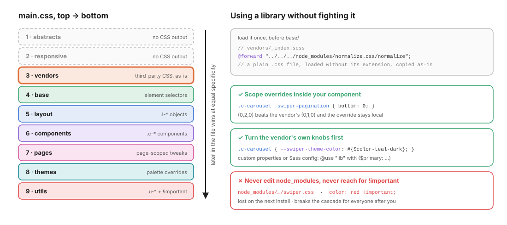

# 04 · Vendors: third-party CSS, without the fight

> `vendors/` holds CSS **you did not write**: a normalize, a carousel, a date picker.
> Load it **once**, **early**, **untouched**, and customise it from your own layers.

← [03 · Responsive](03-responsive.md) · [Index](README.md) · Next → [05 · Base](05-base.md)

```text
vendors/
└── _index.scss    // Third-party CSS (normalize.css, swiper, etc.) goes here.
```

In this kata the folder is intentionally empty: the reset in [`base/_reset.scss`](../src/scss/base/_reset.scss) covers everything the design needs. This chapter explains how to use it when you *do* need a library.

---

## 1. Why vendors come third



Vendor stylesheets are mostly **low-specificity, generic rules** (`.swiper-slide`, `button`, `[type="checkbox"]`). Placing them right after the tools and **before `base/`** means:

- your reset and typography (layer 4) can **normalise** what the library left inconsistent,
- your components (layer 6) come **later**, so at equal specificity they win by source order,
- you almost never need `!important` to override a library.

---

## 2. Loading a library

### Option A: relative path to a plain `.css` file (works everywhere)

```scss
// vendors/_index.scss
@forward "../../../node_modules/normalize.css/normalize";
```

- `@use` / `@forward` load the plain CSS file as a module and copy it **verbatim** into the output, with or without the `.css` extension. Omitting it is the convention, like for `.scss` partials.
- ⚠️ Never use the legacy `@import "….css"`: with a `.css` extension, Sass keeps it as a plain CSS `@import` that the browser fetches **at runtime**. That means an extra request, and the file escapes your build.
- The path is relative to the `vendors/` folder: `src/scss/vendors → ../../../` = the project root.

### Option B: `pkg:` URLs (cleaner, needs configuration)

Dart Sass ≥ 1.71 can resolve `pkg:` URLs through Node's package resolution:

```scss
@forward "pkg:normalize.css/normalize";
```

This only works if the compiler is given a Node package importer: `--pkg-importer=node` on the CLI, or `importers: [new NodePackageImporter()]` in the JS API. With Vite, that means passing it in `css.preprocessorOptions.scss`. Check that your Vite and Sass versions support it before relying on it; option A has no such requirement.

### One library, one partial

When a library has its own customisation, give it a dedicated partial so the index stays a simple list:

```text
vendors/
├── _index.scss       @forward "normalize"; @forward "swiper";
├── _normalize.scss   @forward "../../../node_modules/normalize.css/normalize";
└── _swiper.scss      @forward "../../../node_modules/swiper/swiper";
```

---

## 3. Customising a library, in order of preference

| # | Technique | Example | Why |
| - | --------- | ------- | --- |
| 1 | **Use the library's own knobs**: CSS custom properties or Sass configuration | `.c-carousel { --swiper-theme-color: #{$color-teal-dark}; }` or `@use "lib" with ($primary: $color-ink);` | Official API; survives library updates |
| 2 | **Scope overrides inside your component** | `.c-carousel .swiper-pagination { bottom: 0; }` | `(0,2,0)` beats the vendor's `(0,1,0)`, and the override only affects your carousel |
| 3 | **Wrap the vendor markup in your own `c-` block** | `<div class="c-carousel"><div class="swiper">…` | Your component owns the skin, the library owns the mechanics |
| ✗ | Edit files in `node_modules/` | | Lost on the next `npm install` |
| ✗ | Copy-paste the vendor CSS into your code base and edit it | | You now maintain a fork |
| ✗ | `!important` on top of vendor rules | | Starts a specificity war (see [01](01-architecture.md#4-specificity-only-goes-up)) |

> **Rule of thumb**: library overrides belong in the **component that uses the library**, not in `vendors/`. The vendors folder stays a pristine copy of upstream.

---

## ✅ Checklist: vendors

- [ ] Every third-party stylesheet is loaded from `vendors/`, nowhere else.
- [ ] Paths to plain `.css` files are written without the extension.
- [ ] No vendor file has been edited or copy-pasted.
- [ ] Overrides use the library's custom properties or Sass config first.
- [ ] Remaining overrides are scoped under a `c-` block.

Next → [05 · Base](05-base.md): the reset and typography every element inherits.
