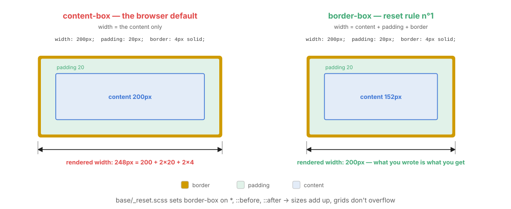
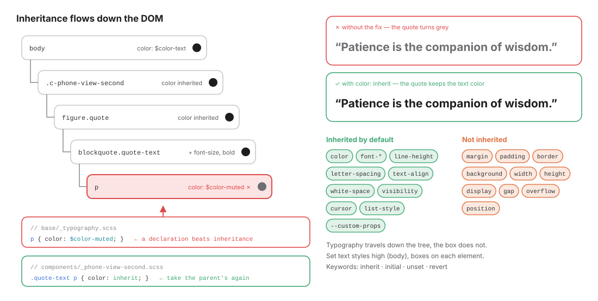

# 05 · Base: the reset and the defaults every element inherits

> `base/` styles **HTML elements**, not classes: `*`, `body`, `h1`, `p`, `img`, `fieldset`…
> It makes every browser start from the same predictable box and gives the page its default typography.

← [04 · Vendors](04-vendors.md) · [Index](README.md) · Next → [06 · Layout](06-layout.md)

```text
base/
├── _index.scss        @forward "reset"; @forward "typography";
├── _reset.scss        11 numbered rules: box model, margins, media, forms, text wrapping…
└── _typography.scss   body font & colours, heading scale, paragraph colour, @font-face
```

---

## 1. What belongs in base, and what does not

| ✓ Belongs in `base/` | ✗ Does not |
| -------------------- | ---------- |
| Universal and element selectors: `*`, `body`, `h1–h6`, `p`, `a`, `img` | Any class (`.title`, `.card`) |
| Attribute selectors that describe semantics: `ul[role="list"]` | Layout (`display: grid` on `main`) |
| Default typography: font family, size, line height, colours | Decorative skin (backgrounds, shadows) on elements |
| `@font-face` declarations | Anything that only one component needs |

Specificity stays at `(0,0,0)`–`(0,1,1)`, so every later layer can override base with a single class.

---

## 2. The reset, rule by rule

[`base/_reset.scss`](../src/scss/base/_reset.scss) is a modern, minimal reset (inspired by Josh Comeau's). Every rule fixes a concrete problem:

| # | Rule | Selector | Problem it solves |
| - | ---- | -------- | ----------------- |
| 1 | `box-sizing: border-box` | `*, *::before, *::after` | `width` ignores padding and border by default, so sizes don't add up (see §3) |
| 2 | `margin: 0` | `*` | Browser default margins on `h1`, `p`, `ul`, `figure`… are inconsistent and leak outside components |
| 3 | `line-height: 1.5` | `body` | Default ~1.2 is too tight for reading (WCAG 1.4.8 recommends at least 1.5) |
| 4 | `-webkit-font-smoothing: antialiased` | `body` | Thinner, crisper text on macOS |
| 5 | `display: block; max-width: 100%` | `img, picture, video, canvas, svg` | Inline media leave a mysterious gap under them, and overflow their container |
| 6 | `font: inherit` | `input, button, textarea, select` | Form controls ignore the page font by default |
| 7 | `overflow-wrap: break-word` | `p, h1–h6` | Long words and URLs overflow narrow boxes |
| 8 | `text-wrap: pretty` / `balance` | `p` / `h1–h6` | Avoids orphans in paragraphs; balances heading lines |
| 9 | `padding: 0; list-style: none` | `ul[role="list"], ol[role="list"]` | Strips bullets **only** on lists you explicitly announce as lists (Safari drops list semantics when `list-style: none`, so `role="list"` restores it) |
| 10 | `min-width: 0; padding: 0; border: 0` | `fieldset` | Fieldsets have chrome *and* a `min-width: min-content` that breaks flex/grid shrinking |
| 11 | `isolation: isolate` | `#root, #__next` | Creates a root stacking context so app `z-index`es never fight portals/modals |

> **Why rule 9 uses `[role="list"]`**: it is opt-in. A plain `<ul>` in an article keeps its bullets; a `<ul class="things-list" role="list">` used as a layout list loses them. Semantics drive style, not the other way round.

> **Rule 11 uses an ID selector**, the only one in the code base. It targets framework mount points by convention and is harmless here (no such element exists in this kata).

---

## 3. `box-sizing`: the rule that makes sizes add up



With the browser default `content-box`, `width: 200px; padding: 20px; border: 4px` renders **248px** wide. With `border-box`, it renders **200px**: padding and border are taken *from inside* the declared width.

Why it matters for layout:

- A grid column of `350px` holds a phone of `width: 100%` **plus** its padding without overflowing.
- `flex-basis` and `grid-template-columns` values mean what they say.
- You can add padding to a component without recalculating its width.

`::before` and `::after` are included because pseudo-elements are boxes too (the stress wave in screen 1 is a `::before`).

---

## 4. Typography defaults

[`base/_typography.scss`](../src/scss/base/_typography.scss) sets the defaults that **inherit** down the tree:

```scss
body {
  font-family: $font-family-base;   // "Wotfard", sans-serif
  font-size: $font-size-base;       // 1rem
  line-height: $line-height-base;   // 1.5
  color: $color-text;               // #1d1d1f
  background-color: $color-bg;
  -webkit-font-smoothing: antialiased;
  text-rendering: optimizeLegibility;
}
h1 { font-size: $font-size-2xl; }
h2 { font-size: $font-size-xl; }
h3 { font-size: $font-size-lg; }

p { color: $color-muted; }          // ← remember this one
```

### `@font-face` with `font-display: swap`

```scss
@font-face {
  font-family: "Wotfard";
  src: url("../fonts/wotfard/regular/wotfard-regular-webfont.woff2") format("woff2");
  font-weight: $font-weight-regular;
  font-style: normal;
  font-display: swap;    // show fallback text immediately, swap when the font arrives
}
```

One `@font-face` per weight, all with the same `font-family` name, lets you write `font-weight: 300` and get the right file.

---

## 5. Inheritance: what flows down, and the `p` trap

Typography properties **inherit**: set `color` on `body` and every descendant gets it, unless something closer says otherwise. Box properties (margin, padding, background, display…) do **not** inherit.



| Inherited by default | Not inherited |
| -------------------- | ------------- |
| `color`, `font-*`, `line-height`, `letter-spacing`, `text-align`, `white-space`, `visibility`, `cursor`, `list-style`, **custom properties** (`--x`) | `margin`, `padding`, `border`, `background`, `width`, `height`, `display`, `gap`, `overflow`, `position` |

### The trap

A **direct declaration always beats an inherited value**, however weak its selector. So `p { color: $color-muted; }` in base wins over `color: $color-text` inherited from a component, even though the component's selector is "stronger". Specificity only compares rules that target **the same element**.

In screen 2 the quote is a `<blockquote class="quote-text"><p>…</p></blockquote>`. Without a fix, the quote turns grey:

```scss
// components/_phone-view-second.scss
& .quote {
  &-text {
    font-size: $font-size-xl;
    font-weight: $font-weight-bold;

    & p {
      color: inherit;     // ← take the parent's colour again, beating base's p rule
    }
  }
}
```

> **Rule**: when a component contains semantic elements styled by base (`p`, `h2`, `a`), decide explicitly whether it wants base's look or its own. `color: inherit` is the cleanest way to opt out.

---

## ✅ Checklist: base

- [ ] `base/` contains no class selectors.
- [ ] `box-sizing: border-box` is applied to `*, *::before, *::after`.
- [ ] Default margins are removed; spacing is re-added with `gap`/`padding` in layout and components.
- [ ] Lists used for layout carry `role="list"`.
- [ ] Every `@font-face` has `font-display: swap`.
- [ ] Components that contain `p`, headings or links decide explicitly whether to inherit base's colours.

Next → [06 · Layout](06-layout.md): Grid and Flex in depth, and the `l-` contract.
