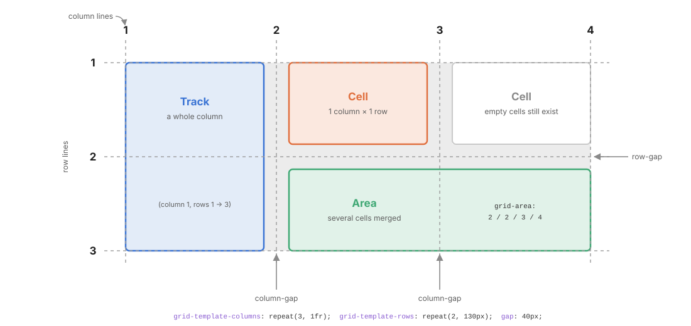
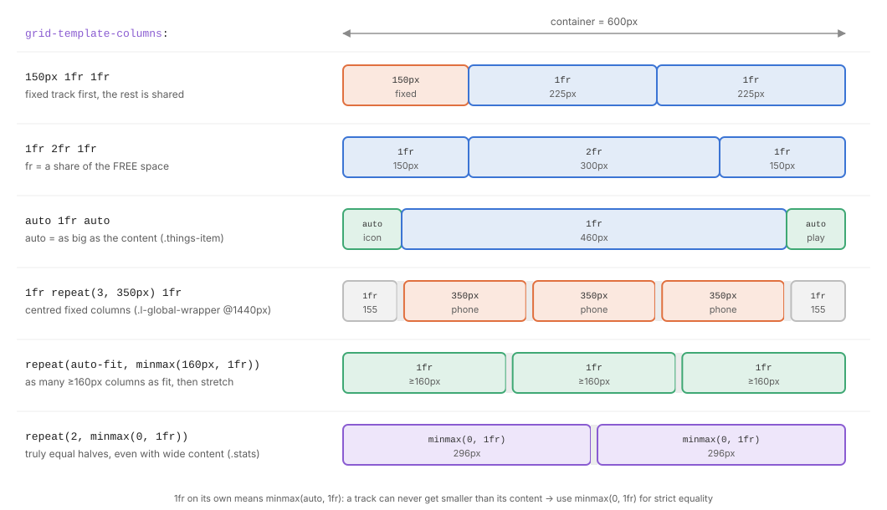
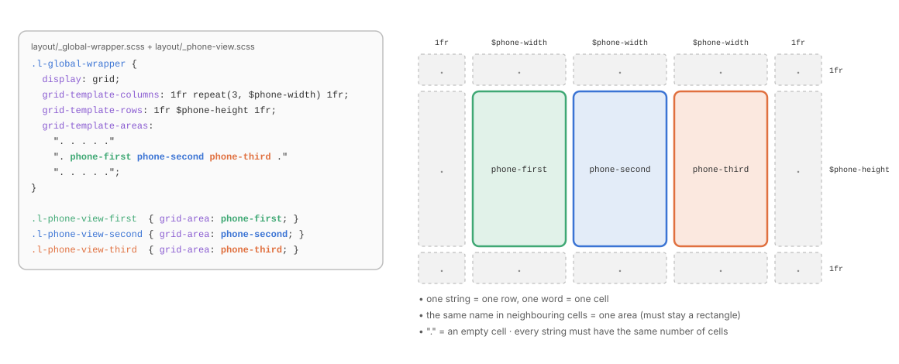
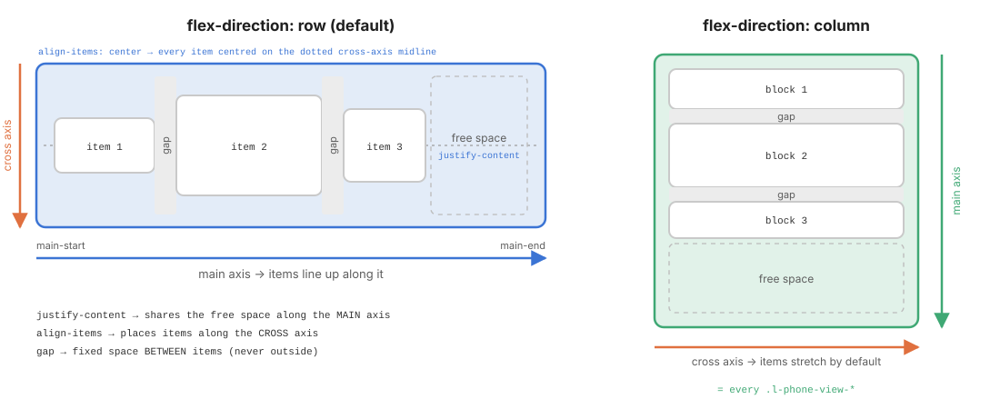
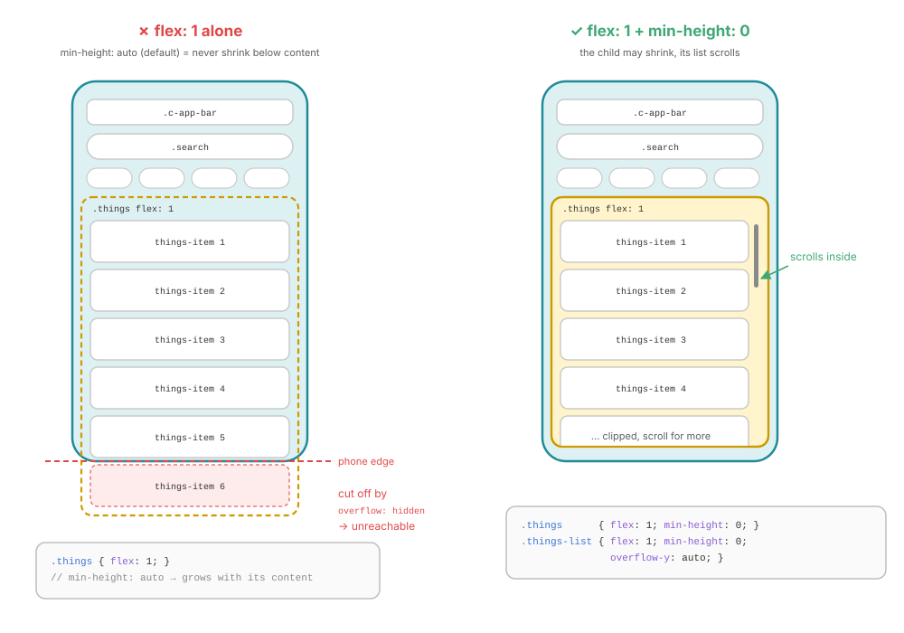
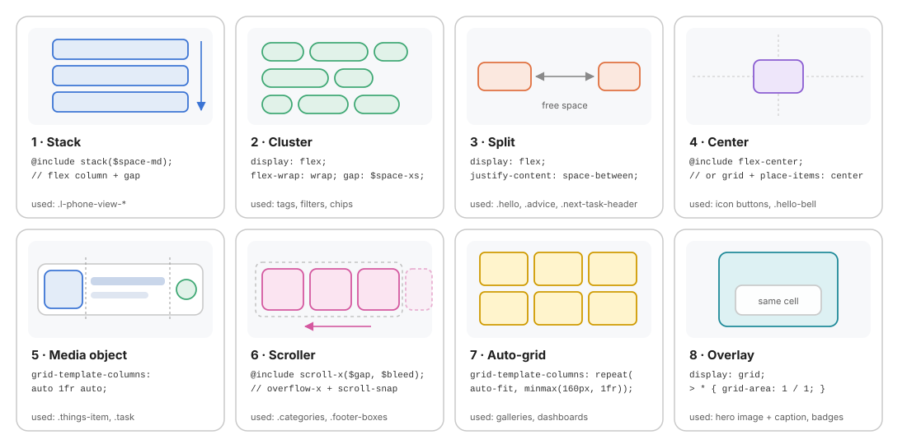

# 06 · Layout: Grid and Flex in depth, and the `l-` contract

> A layout class answers **one question**: *where do my children go?*
> It draws the map (grid) or the flow (flex) and **never paints anything**.

← [05 · Base](05-base.md) · [Index](README.md) · Next → [07 · Components](07-components.md)

```text
layout/
├── _index.scss            @forward "global-wrapper"; @forward "phone-view";
├── _global-wrapper.scss   .l-global-wrapper   → the page grid: 3 phone areas, redrawn at 2 breakpoints
└── _phone-view.scss       .l-phone-view-*     → place each phone in its area + stack its children
```

---

## 1. The `l-` contract in one table

| An `l-` class **owns** | An `l-` class **never touches** |
| ---------------------- | ------------------------------- |
| *Its own position* in the parent map: `grid-area`, `grid-column`, `grid-row` | Colours, backgrounds, borders, shadows, radius |
| *Its children's flow*: `display: grid / flex`, `grid-template-*`, `flex-direction`, `flex-wrap` | Typography: font, size, weight, colour |
| *Spacing between children*: `gap`, `row-gap`, `column-gap` | Padding (the inside belongs to the component) |
| *Alignment of children*: `justify-*`, `align-*`, `place-*` | States: `:hover`, `:focus`, `:checked` |
| *The page-level frame*: `min-height: 100dvh` on the root grid | Anything inside a child component |

> Grid and flex are **not reserved** for `l-` classes. A component arranges its **own internal parts** with them (`.things-item` is a grid, `.search` is a flex row). The `l-` layer arranges **independent blocks** relative to each other. The full ownership table and the gray zones are in [08 · Layout vs Components](08-layout-vs-components.md).

---

## 2. Grid vocabulary

Grid is **two-dimensional**: you draw rows **and** columns on the parent, then drop children into the cells.



| Term | What it is | How you address it |
| ---- | ---------- | ------------------ |
| **Line** | The numbered border between tracks. *n* tracks have *n + 1* lines; negative numbers count from the end (`-1` = last line) | `grid-column: 2 / 4` |
| **Track** | A whole column or row: the space between two adjacent lines | `grid-template-columns: 150px 1fr` |
| **Cell** | The intersection of one row and one column; the smallest unit. Empty cells still take up space | implicit |
| **Area** | A rectangle of one or more cells | `grid-area: 2 / 2 / 3 / 4` or a name |
| **Gap** | The gutter between tracks; never on the outer edges | `gap: row column` |

### Container properties (on the parent)

| Property | Role | Example |
| -------- | ---- | ------- |
| `display: grid` | Turns the box into a grid container | |
| `grid-template-columns` / `-rows` | Draws the explicit tracks | `1fr repeat(3, $phone-width) 1fr` |
| `grid-template-areas` | Names areas with an ASCII map (§4) | `"date title" "date practice"` |
| `gap` / `row-gap` / `column-gap` | Gutter between tracks | `gap: $space-xs $space-sm` |
| `grid-auto-rows` / `-columns` | Size of tracks created **implicitly** for extra items | `grid-auto-rows: minmax(100px, auto)` |
| `grid-auto-flow` | Fill order for auto-placed items (`row`, `column`, `dense`) | `grid-auto-flow: dense` |
| `justify-items` / `align-items` / `place-items` | Align every item **inside its cell** | `place-items: center` |
| `justify-content` / `align-content` | Align the **whole grid** inside the container when the tracks are smaller | `justify-content: center` |

### Item properties (on the children)

| Property | Role | Example |
| -------- | ---- | ------- |
| `grid-area` | Place by name, or `row-start / col-start / row-end / col-end` | `grid-area: phone-first` |
| `grid-column` / `grid-row` | Place by lines; `span n` to stretch | `grid-column: 1 / -1` (full width) |
| `justify-self` / `align-self` / `place-self` | Override alignment for this item only | `align-self: end` (`.things-item-title`) |
| `order` | Change the visual order (⚠️ not the tab order: avoid) | |

> **Legacy names.** `grid-column-gap` and `grid-row-gap` (used in [`_global-wrapper.scss`](../src/scss/layout/_global-wrapper.scss)) are the old aliases of `column-gap` and `row-gap`. Browsers keep supporting them, but prefer the short names in new code: they also work in flex containers.

---

## 3. Sizing tracks

The track list is where the magic happens. Each value answers *"how wide is this column?"* in a different way:



| Unit / function | Meaning | Use it for |
| --------------- | ------- | ---------- |
| `150px`, `$phone-width` | Fixed size | Sidebars, the phones |
| `1fr` | One **share of the free space**, i.e. what is left after fixed and `auto` tracks are sized | Flexible columns |
| `auto` | As big as the content (then stretches if there is free space and no `fr`) | Icons, buttons, labels: `.things-item` → `auto 1fr auto` |
| `minmax(min, max)` | Never smaller than *min*, never larger than *max* | `minmax(0, $phone-width)`: shrinkable phone column |
| `repeat(n, track)` | Repeat a pattern | `repeat(3, $phone-width)` |
| `repeat(auto-fit, minmax(160px, 1fr))` | As many ≥160px columns as fit; collapse empty ones so the items stretch | Responsive card grids **without media queries** |
| `repeat(auto-fill, …)` | Same, but **keep** empty tracks: items do not stretch | Grids that must stay aligned with a fixed rhythm |
| `fit-content(300px)` | Like `auto`, but capped | A label column that should not grow forever |

### The `1fr` trap → `minmax(0, 1fr)`

`1fr` really means `minmax(auto, 1fr)`: a track **can never become narrower than its content's minimum width**. One long word or a wide image makes "equal" columns unequal, or overflows the grid.

```scss
// components/_phone-view-third.scss
& .stats {
  display: grid;
  grid-template-columns: repeat(2, minmax(0, 1fr));   // ← strictly equal halves
  …
}
```

> **Rule**: when columns *must* be equal, write `minmax(0, 1fr)`. When the content must never be squeezed, keep `1fr` or use `auto`.

---

## 4. Named areas: draw the map in ASCII

`grid-template-areas` is the most readable way to build a layout. The parent draws the map; each child only says *which area* it lives in.



```scss
// layout/_global-wrapper.scss
.l-global-wrapper {
  display: grid;
  grid-template-columns: 1fr repeat(3, $phone-width) 1fr;
  grid-template-rows: 1fr $phone-height 1fr;
  grid-template-areas:
    ". . . . ."
    ". phone-first phone-second phone-third ."
    ". . . . .";
}

// layout/_phone-view.scss
.l-phone-view-first  { grid-area: phone-first; }
.l-phone-view-second { grid-area: phone-second; }
.l-phone-view-third  { grid-area: phone-third; }
```

### The rules of the map

1. **One string = one row; one word = one cell.**
2. Every string must contain **the same number of cells**, matching the number of columns.
3. The **same name in neighbouring cells** merges them into one area. An area must be a **rectangle** (no L or T shapes), otherwise the whole declaration is invalid and silently ignored.
4. `.` (or `...`) is an **empty cell**.
5. Extra spaces are ignored, so you may align the columns for readability.
6. Names are free identifiers: pick **semantic** names (`header`, `sidebar`, `phone-first`), never positional ones (`top-left`).

### Why names beat line numbers

| With line numbers | With named areas |
| ----------------- | ---------------- |
| `grid-column: 3 / 4; grid-row: 2 / 3;` | `grid-area: phone-second;` |
| Every child must change at every breakpoint | **Only the parent's map changes**, children never move in the code ([03](03-responsive.md#4-responsive--redraw-the-map)) |
| You must count lines to understand the layout | The layout is **visible** in the source |

The same technique works **inside** components. Screen 2's quote and screen 3's task cards both use a two-row map:

```scss
// components/_phone-view-third.scss
& .task {
  display: grid;
  grid-template-columns: auto 1fr;
  grid-template-areas:
    "date title"
    "date practice";      // "date" spans both rows → a vertical rectangle
  gap: $space-xs $space-sm;

  &-date { grid-area: date; align-self: stretch; … }
}
```

---

## 5. Flex vocabulary

Flex is **one-dimensional**: items line up along a single **main axis**, and you control how they share the free space on it.



| Term | Row (default) | Column |
| ---- | ------------- | ------ |
| **Main axis**: items line up along it | horizontal → | vertical ↓ |
| **Cross axis**: perpendicular | vertical | horizontal |
| `justify-content` works on | the main axis | the main axis |
| `align-items` works on | the cross axis | the cross axis |

> Changing `flex-direction` **swaps the axes**, so `justify-content` and `align-items` swap their visual effect. If centring "doesn't work", check the direction first.

### Container properties

| Property | Values you will actually use | Effect |
| -------- | ---------------------------- | ------ |
| `display: flex` / `inline-flex` | | Block-level vs inline-level container |
| `flex-direction` | `row`, `column` | Choose the main axis |
| `flex-wrap` | `nowrap` (default), `wrap` | Allow items to break onto new lines |
| `justify-content` | `flex-start`, `center`, `space-between`, `space-around`, `space-evenly` | Share the **free space** along the main axis |
| `align-items` | `stretch` (default), `center`, `flex-start`, `flex-end`, `baseline` | Position items on the cross axis |
| `align-content` | same as justify | Only with `wrap`: align the **lines** |
| `gap` | `$space-*` | Fixed space **between** items, never outside |

### Item properties

| Property | Effect |
| -------- | ------ |
| `flex-grow` | Share of the **free** space the item takes (0 = none) |
| `flex-shrink` | Share of the **missing** space the item gives up (0 = never shrink) |
| `flex-basis` | Starting size before grow/shrink (`auto` = use `width`/`height` or content) |
| `flex` | Shorthand for the three above (see §6) |
| `align-self` | Override `align-items` for one item |
| `margin-inline-start: auto` | Pushes the item (and everything after it) to the end: the "spacer" trick |

---

## 6. Flex sizing: `flex: 1` and the min-size trap

### The `flex` shorthand, decoded

| You write | Means | Behaviour |
| --------- | ----- | --------- |
| `flex: 1` | `1 1 0%` | Ignore content size, take an **equal share** of all the space |
| `flex: auto` | `1 1 auto` | Start from content size, then grow/shrink |
| `flex: none` | `0 0 auto` | Rigid: exactly its content size |
| `flex: 0 0 3rem` | | Fixed 3rem, never grows or shrinks |
| `flex-shrink: 0` | | Keep the content size even when space runs out (`.things-item`, `circle()`, `scroll-x` children) |

### The trap

Flex (and grid) items have `min-width: auto` / `min-height: auto` by default: **an item never shrinks below its content's size**. So `flex: 1` alone is not enough to make a box "fill the remaining space and scroll": it fills the space **and keeps growing** with its content, pushing past the parent.



The real code in screen 2:

```scss
// components/_phone-view-second.scss
& .things {
  display: flex;
  flex-direction: column;
  flex: 1;             // take the space left under the search bar
  gap: $space-sm;
  min-height: 0;       // ← allowed to be smaller than its content

  &-list {
    display: flex;
    flex-direction: column;
    flex: 1;
    gap: $space-sm;
    min-height: 0;     // ← same, one level deeper
    overflow-y: auto;  // now the overflow scrolls INSIDE the list
    …
  }

  &-item {
    flex-shrink: 0;    // ← items keep their height; the LIST scrolls
    …
  }
}
```

**Every level** between the fixed-height ancestor (the 700px phone) and the scrolling element needs `min-height: 0`. Miss one, and the chain breaks.

| Symptom | Cause | Fix |
| ------- | ----- | --- |
| A `flex: 1` column overflows its parent instead of scrolling | `min-height: auto` | `min-height: 0` on every flex item in the chain |
| A text input in a flex row won't shrink, pushing a button out | `min-width: auto` (inputs have an intrinsic width) | `flex: 1; min-width: 0` (`.search-input`) |
| Ellipsis / `line-clamp` never kicks in inside a flex item | same | `min-width: 0` on the item |
| Items get squashed when the list is longer than the container | `flex-shrink: 1` (default) | `flex-shrink: 0` on the items |

---

## 7. Alignment cheat sheet

| I want to… | Grid | Flex |
| ---------- | ---- | ---- |
| Centre one child both ways | `display: grid; place-items: center;` | `@include flex-center;` |
| Push items to opposite ends | `grid-template-columns: auto 1fr auto` | `justify-content: space-between` |
| Push only the last item to the end | `grid-column: -2 / -1` | `margin-inline-start: auto` on it |
| Align text baselines in a row | `align-items: baseline` | `align-items: baseline` |
| Make one child fill the remaining space | a `1fr` track | `flex: 1` (+ `min-*: 0`) |
| Stack children with equal spacing | `display: grid; gap: …` | `flex-direction: column; gap: …` |

> **Spacing rule**: space **between** siblings is always the parent's `gap`. Never put `margin-top` on children to separate them: it leaks outside the first/last child and breaks when items are reordered or hidden.

---

## 8. The eight layout patterns

Almost every interface is a combination of these eight arrangements. Learn to spot them during the [squint test](00-mental-model.md#2-the-squint-test).



```scss
// 1 · Stack: vertical rhythm. The project writes it by hand in .l-phone-view-*;
//     the stack() mixin compiles to exactly the same three lines.
.l-stack { display: flex; flex-direction: column; gap: $space-md; }

// 2 · Cluster: items that wrap onto new lines (tags, filters, chips)
.l-cluster { display: flex; flex-wrap: wrap; gap: $space-xs; }

// 3 · Split: two groups pushed to opposite ends (.hello, .advice, .next-task-header)
.l-split { display: flex; justify-content: space-between; align-items: center; }

// 4 · Center: one child in the middle (icon buttons, .hello-bell)
.l-center { display: grid; place-items: center; }      // or @include flex-center;

// 5 · Media object: fixed | fluid | fixed (.things-item, .task)
.l-media { display: grid; grid-template-columns: auto 1fr auto; align-items: center; gap: $space-sm; }

// 6 · Scroller: one row that scrolls horizontally (.categories, .footer-boxes)
.l-scroller { @include scroll-x($space-xs, $space-md); }

// 7 · Auto-grid: responsive cards without media queries
.l-auto-grid { display: grid; grid-template-columns: repeat(auto-fit, minmax(160px, 1fr)); gap: $space-md; }

// 8 · Overlay: children stacked in the same cell (caption on an image, badge on an avatar)
.l-overlay { display: grid; > * { grid-area: 1 / 1; } }
```

> The "Overlay" pattern replaces most `position: absolute` hacks. Items stay in the flow, so the container still grows to fit the tallest one.

### Reusable `l-` utilities or not?

These snippets are written as standalone `l-` classes to show the pattern. In this project the patterns live **inside** the component that uses them (`.hello` is a split, `.things-item` a media object). Both are valid:

- **Inline the pattern** when the arrangement is part of the component's identity (a `.things-item` is always a media object).
- **Extract an `l-` class** when the same arrangement wraps **different** components across pages (a `.l-cluster` of buttons, badges, or chips).

---

## 9. The project's layout classes

```html
<div class="l-global-wrapper c-global-wrapper">
  <div class="c-phone-view l-phone-view-first c-phone-view-first">…</div>
  <div class="c-phone-view l-phone-view-second c-phone-view-second">…</div>
  <div class="c-phone-view l-phone-view-third c-phone-view-third">…</div>
</div>
```

```scss
// layout/_phone-view.scss
.l-phone-view {
  &-first,
  &-second,
  &-third {
    display: flex;            // ┐
    flex-direction: column;   // ├ the Stack pattern: each phone's children flow top → bottom
    gap: $space-md;           // ┘
  }

  &-first  { grid-area: phone-first; }    // where *I* sit in the parent map
  &-second { grid-area: phone-second; }
  &-third  { grid-area: phone-third; gap: 0.75rem; }
}
```

Read the HTML from left to right:

| Class | Layer | Answers |
| ----- | ----- | ------- |
| `c-phone-view` | component | *What do all phones look like?* Green background, 25px radius, `overflow: hidden` |
| `l-phone-view-first` | layout | *Where is this phone, and how do its children flow?* Area `phone-first`, flex column, `gap` |
| `c-phone-view-first` | component | *What is inside this phone?* Padding and every internal block of screen 1 |

---

## 10. Allowed and forbidden in an `l-` class

| ✓ Allowed | ⚠️ Case by case | ✗ Forbidden |
| --------- | --------------- | ----------- |
| `display: grid / flex` | `width`, `max-width`, `min-height` (frame of the page) | `color`, `background`, `border`, `box-shadow` |
| `grid-template-*`, `grid-auto-*` | `container-type` (to enable container queries) | `font-*`, `text-*`, `line-height` |
| `grid-area`, `grid-column`, `grid-row` | `overflow` (when the layout creates a scroll region) | `padding` (the inside is the component's) |
| `flex-direction`, `flex-wrap` | `position: sticky` (sticky header area) | `:hover`, `:focus`, `:checked` states |
| `gap`, `row-gap`, `column-gap` | | `margin` to separate siblings (use `gap`) |
| `justify-*`, `align-*`, `place-*` | | Descendant selectors into a component: `.l-x .c-card .title` |
| Breakpoints that redraw the map | | |

---

## ✅ Checklist: layout

- [ ] Each region is a grid or a flex container chosen with the [decision tree](00-mental-model.md#6-the-decision-tree).
- [ ] Page-level grids use **named areas**; children only declare `grid-area: name`.
- [ ] Equal columns use `minmax(0, 1fr)`.
- [ ] Every `flex: 1` that must scroll or shrink has `min-height: 0` / `min-width: 0` on **every** level.
- [ ] Spacing between siblings is a `gap`, never a margin on the children.
- [ ] No colour, font, border or padding in any `l-` class.
- [ ] Breakpoints redraw the map in the `l-` class; components are untouched.

Next → [07 · Components](07-components.md): the `c-` block, its parts, its states.
