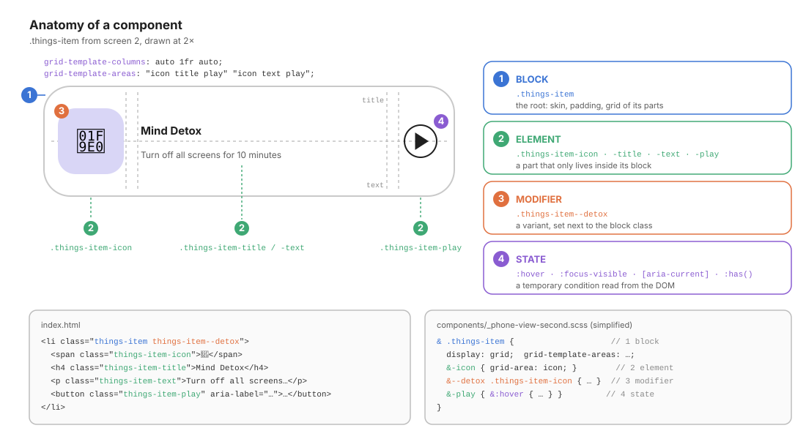
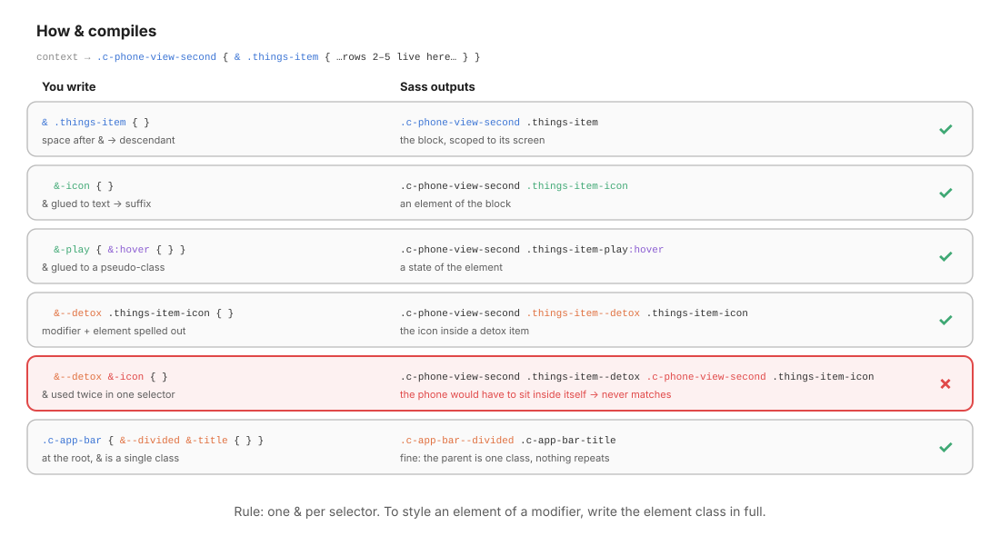
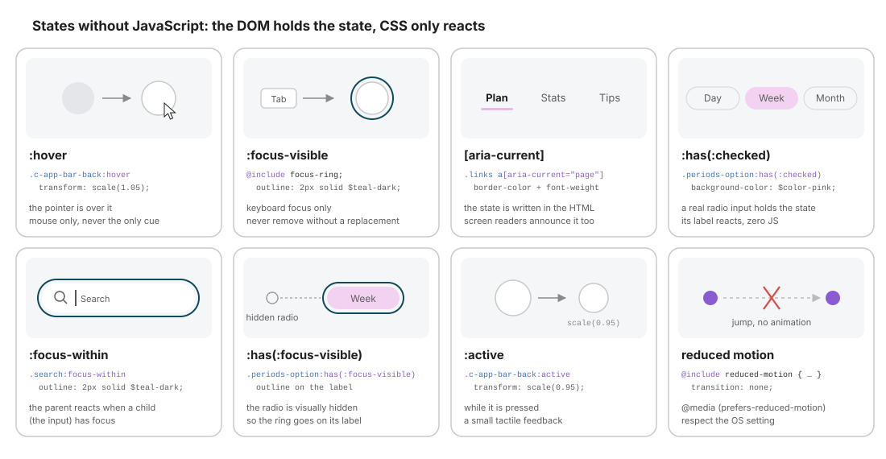

# 07 · Components: the `c-` block, its parts, its states

> A component answers **one question**: *what does this thing look like, and how does it behave?*
> It owns its skin, its padding, its internal arrangement and its states. It **never** decides where it sits on the page.

← [06 · Layout](06-layout.md) · [Index](README.md) · Next → [08 · Layout vs Components](08-layout-vs-components.md)

```text
components/
├── _index.scss               @forward every component, in order
├── _global-wrapper.scss      .c-global-wrapper   → black page background
├── _icon.scss                .c-icon             → stroke icons from the SVG sprite
├── _app-bar.scss             .c-app-bar          → back button + title (screens 2 & 3)
├── _phone-view.scss          .c-phone-view       → the phone frame shared by all screens
├── _phone-view-first.scss    .c-phone-view-first  → screen 1 and its internal blocks
├── _phone-view-second.scss   .c-phone-view-second → screen 2 and its internal blocks
└── _phone-view-third.scss    .c-phone-view-third  → screen 3 and its internal blocks
```

---

## 1. The `c-` contract

| A `c-` class **owns** | A `c-` class **never** |
| --------------------- | ---------------------- |
| Skin: `background`, `border`, `border-radius`, `box-shadow`, `color` | Sets its own `grid-area` / `grid-column` (that is the parent `l-`'s job) |
| Typography: `font-*`, `line-height`, `text-*` | Adds outer `margin` to push itself away from siblings (parent's `gap`) |
| **Padding**: the space inside its border | Hard-codes a width that only makes sense in one context |
| Its **internal** arrangement: a grid or flex of its own parts | Styles another component's internals (`.c-card .c-button-label`) |
| Its states: `:hover`, `:focus-visible`, `:has(:checked)`, `[aria-*]` | Depends on its parent's class to look right |
| Motion, and the reduced-motion fallback | |

A good component passes the **context-free test**: drop it into an empty page, inside any container, and it still looks right. It fills the width it is given and lets its parent decide everything else ([08](08-layout-vs-components.md)).

---

## 2. Anatomy: block, element, modifier, state

Every component is built from four kinds of selectors. The naming tells you which one you are looking at **from the HTML alone**.



| Kind | Naming in this project | Example | Rule |
| ---- | ---------------------- | ------- | ---- |
| **Block** | `name` (root of the thing) | `.things-item`, `.c-app-bar` | Owns the skin, the padding and the grid/flex of its parts |
| **Element** | `block-part`: **one** hyphen | `.things-item-icon`, `.c-app-bar-title` | Only exists inside its block; never styled on its own |
| **Modifier** | `block--variant`: **two** hyphens | `.things-item--detox`, `.c-app-bar--divided` | Set **next to** the block class: `class="things-item things-item--detox"` |
| **State** | pseudo-class or ARIA attribute | `:hover`, `:focus-visible`, `:has(:checked)`, `[aria-current="page"]` | A temporary condition, read from the DOM, never a class like `.is-active` when HTML can express it |

> **Classic BEM** writes elements with two underscores (`.things-item__icon`). This project uses a single hyphen, which reads better in Sass (`&-icon`) and is just as unambiguous, because modifiers always use `--`. Pick one convention per project and never mix them.

### Rules for names

- Name **what it is**, not what it looks like: `.advice-tag`, not `.pink-pill`. The colour will change; the role won't.
- Elements are **flat**: `.things-item-play`, never `.things-item-header-actions-play`. If you need a third level, you probably found a new block.
- A modifier never stands alone: `class="things-item--detox"` without `things-item` is a bug.

---

## 3. How `&` compiles

Sass's `&` is replaced by **the full parent selector**, wherever you put it. Most of the time that is what you want; once in a while it produces a selector that can never match.



| You write (inside `.c-phone-view-second`) | Sass outputs | |
| ----------------------------------------- | ------------ | - |
| `& .things { }` | `.c-phone-view-second .things` | ✓ descendant (space after `&`) |
| `&-list { }` (inside `.things`) | `.c-phone-view-second .things-list` | ✓ suffix: an element |
| `&:hover { }` | `….things-item-play:hover` | ✓ a state of the element |
| `&--detox .things-item-icon { }` | `….things-item--detox .things-item-icon` | ✓ element of a modifier, spelled out |
| `&--detox &-icon { }` | `.c-phone-view-second .things-item--detox .c-phone-view-second .things-item-icon` | ✗ the phone would have to be inside itself |
| `.c-app-bar { &--divided &-title { } }` | `.c-app-bar--divided .c-app-bar-title` | ✓ at the root, `&` is a single class |

**Rule: one `&` per selector when the block is nested.** To style an element of a modifier, write the element class in full, as the project does:

```scss
// components/_phone-view-second.scss
&-item {
  …
  &--detox .things-item-icon    { background-color: $color-lavender; }
  &--gratitude .things-item-icon { background-color: $color-sky; }
  &--breath .things-item-icon   { background-color: $color-mint; }
}
```

> **How to check**: compile and read the output. `npx sass src/scss/main.scss | grep detox` shows the exact selector in two seconds. Never trust nested `&` you have not seen compiled.

---

## 4. The file skeleton

Every component file follows the same order, so you always know where to look:

```scss
// components/_tag.scss
@use "../abstracts" as *;            // 1. tools (zero CSS output)

$-tag-height: 1.75rem;               // 2. private constants (the "-" makes them file-local)

.c-tag {                             // 3. the block
  @include pill($color-pink);        //    a. mixins first: they are the "base", your lines refine them
  display: inline-flex;              //    b. internal arrangement (display, grid, flex, gap)
  height: $-tag-height;              //    c. box (size, padding)
  border: 1px solid transparent;     //    d. skin (background, border, radius, shadow)
  font-size: $font-size-xs;          //    e. typography
  transition: background-color $transition-base;   // f. motion

  &:hover { … }                      // 4. states of the block
  &:focus-visible { … }

  &-icon { … }                       // 5. elements, in visual order
  &-label { … }

  &--lemon { background-color: $color-lemon; }      // 6. modifiers
  &--lemon &-icon { … }              //    fine here: .c-tag is a root block

  @include reduced-motion {          // 7. media / preference blocks last
    transition: none;
  }
}
```

The real [`_app-bar.scss`](../src/scss/components/_app-bar.scss) follows this skeleton exactly:

```scss
.c-app-bar {
  display: flex;                     // internal arrangement of its parts
  align-items: center;
  gap: $space-md;

  &-back {                           // element
    @include circle($size-control-lg + $space-sm);
    @include focus-ring;
    background-color: $color-surface;
    color: $color-text;
    font-size: $font-size-lg;
    transition: transform $transition-base;

    &:hover  { transform: scale(1.05); }   // states
    &:active { transform: scale(0.95); }
  }

  &-title {                          // element
    flex: 1;
    padding-inline-end: $size-control-lg + $space-sm + $space-md;   // = back button + gap → title truly centred
    font-size: $font-size-sm;
    font-weight: $font-weight-bold;
    text-align: center;
  }

  &--divided &-title {               // modifier
    padding-block: $space-sm;
    border-inline-start: 2px solid $color-overlay-dark;
  }

  @include reduced-motion {          // preferences last
    &-back { transition: none; }
  }
}
```

---

## 5. States without JavaScript

The project has **zero JS**. Every interactive state is stored **in the DOM** (focus, a checked radio, an ARIA attribute) and CSS only **reacts** to it.



| Selector | Fires when | Project example | Notes |
| -------- | ---------- | --------------- | ----- |
| `:hover` | The pointer is over the element | `.c-app-bar-back:hover` | Mouse only: never the **only** cue |
| `:focus-visible` | Keyboard focus (not mouse clicks) | `@include focus-ring` (7 uses) | Never remove an outline without a replacement |
| `:active` | While pressed | `.c-app-bar-back:active` | Tactile feedback |
| `[aria-current="page"]` | The HTML says "this is the current item" | `.links a[aria-current="page"]` | Screen readers announce it too: style **and** semantics in one |
| `:has(:checked)` | A descendant input is checked | `.periods-option:has(:checked)` | Replaces JS tabs/toggles; a real radio holds the state |
| `:focus-within` | Any descendant has focus | `.search:focus-within` | The parent draws the ring; the input removes its own |
| `:has(:focus-visible)` | A descendant has **keyboard** focus | `.periods-option:has(:focus-visible)` | The radio is visually hidden, so the label shows the ring |
| `@include reduced-motion` | The OS asks for less motion | end of every animated component | Turn transitions off; the state change stays |

### The radio-label pattern (tabs, segmented controls, chips)

```html
<fieldset class="periods">
  <legend class="u-sr-only">Period</legend>
  <label class="periods-option">
    <input class="u-sr-only" type="radio" name="period" value="week" checked />
    Week
  </label>
  …
</fieldset>
```

```scss
& .periods-option {
  @include flex-center;
  flex: 1;
  border: 1px solid $color-overlay-dark;
  border-radius: $radius-full;

  &:hover               { background-color: $color-overlay-light; }
  &:has(:checked)       { border-color: transparent; background-color: $color-pink; }
  &:has(:focus-visible) { outline: 2px solid $color-teal-dark; outline-offset: 2px; }
}
```

The radio is hidden with `.u-sr-only`, **not** `display: none`: it stays focusable and is announced by screen readers. Arrow keys switch the selection natively, and the `<legend>` names the group.

---

## 6. Accessibility is part of the component

| Concern | Rule | In this project |
| ------- | ---- | --------------- |
| Focus | Every interactive element shows a visible focus ring | `focus-ring` mixin, `:focus-within`, `:has(:focus-visible)` |
| Icon-only buttons | Need an accessible name | `aria-label="Start Mind Detox"` |
| Decorative glyphs | Hidden from assistive tech | `<span aria-hidden="true">🧠</span>` |
| Hidden labels | Visually hidden, still read | `.u-sr-only` on the search `<label>` and on legends |
| Target size | ≥ 24×24 CSS px (WCAG 2.5.8) | smallest control `$size-control-sm` = 28px |
| Lists used as layout | Keep list semantics | `<ul role="list">` (see [05](05-base.md#2-the-reset-rule-by-rule)) |
| Motion | Respect the user's setting | `@include reduced-motion { transition: none; }` |
| Colour | State never shown by colour alone | checked period = colour **and** border change; current link = pink underline **and** bold weight |

---

## 7. Internal blocks vs standalone components

In this project each **screen** is a component (`.c-phone-view-second`), and its regions are **unprefixed internal blocks** scoped by nesting (`.advice`, `.quote`, `.search`, `.things`). They are real BEM blocks with their own elements and modifiers, but they only exist **inside** that screen.

```text
.c-phone-view-second                    ← standalone component (prefixed, own file)
├── .advice      ├── -tag  -nav  -nav-button          ┐
├── .quote       ├── -text  -illustration  -author    │ internal blocks
├── .search      ├── -input                           │ (unprefixed, scoped by nesting,
├── .categories  ├── -item  --meditation  --relax …   │  compiled as .c-phone-view-second .xxx)
└── .things      ├── -title  -list  -item  -item-icon │
                                                       ┘
.c-app-bar                              ← promoted: used by screens 2 AND 3 → own file, own prefix
```

### Scoped vs standalone

| | Internal block (`.things`) | Standalone component (`.c-app-bar`) |
| - | -------------------------- | ----------------------------------- |
| Prefix | none | `c-` |
| File | inside its parent's partial | its own `components/_name.scss` |
| Compiled selector | `.c-phone-view-second .things` (0,2,0) | `.c-app-bar` (0,1,0) |
| Can be reused elsewhere | ✗ only works inside its parent | ✓ anywhere |
| Name collisions | impossible (scoped) | must be unique project-wide |

### The promotion rule

> **Used in one place → keep it internal. Used in two places → promote it.**

How to promote a block (example: the two pills `.advice-tag` and `.categories-item` become a `.c-tag`):

1. **Create** `components/_tag.scss` with `.c-tag` at the root (no parent nesting), using the [skeleton](#4-the-file-skeleton).
2. **Move** the shared declarations in; turn the differences into modifiers (`.c-tag--pink`, `.c-tag--lemon`).
3. **Forward** it in `components/_index.scss`, **before** the screens that use it.
4. **Replace** the classes in the HTML: `class="c-tag c-tag--pink"`.
5. **Delete** the old nested rules, then compile and check both screens.

> Note the specificity drop: `.c-tag` is `(0,1,0)`, while the old nested rule was `(0,2,0)`. If a screen still has a nested rule that touches the tag, it will now win. Search for leftovers.

### Max three levels of nesting

```scss
.c-phone-view-second {          // 1
  & .things {                   // 2
    &-item {                    // 3 → .c-phone-view-second .things-item
      &:hover { … }             //   states and &-suffixes don't add depth to the output selector
    }
  }
}
```

Deeper nesting produces long selectors with high specificity that are painful to override. If you need a fourth level, the inner part deserves its own block.

---

## 8. Variants: modifier class or custom property?

| Use a **modifier class** when… | Use a **custom property** when… |
| ------------------------------ | -------------------------------- |
| The variant changes **several** declarations | Only **one value** changes |
| The set of variants is small and named (`--detox`, `--divided`) | The value is continuous or set per instance |
| `class="things-item things-item--detox"` | `style="--progress: 62%"` or a parent rule |

Screen 1 uses a custom property as a local knob:

```scss
& .select-box {
  --border-select-box: 35px;          // declared once on the parent…

  &-1,
  &-2 {
    border-radius: var(--border-select-box);   // …read by both children
  }
}
```

Custom properties **inherit**, so a parent can tune its children without a single extra selector, and a theme can override them at runtime ([10](10-themes.md)).

---

## ✅ Checklist: components

- [ ] The block has no `grid-area`, no outer `margin`, no context-dependent width.
- [ ] It passes the context-free test: it looks right in an empty page.
- [ ] Elements use one hyphen, modifiers two; modifiers always sit next to the block class.
- [ ] No selector uses `&` twice when the block is nested; I read the compiled output.
- [ ] The file follows the skeleton: tools → constants → block → states → elements → modifiers → media.
- [ ] Every interactive element has a focus style and an accessible name.
- [ ] States come from the DOM (`:checked`, `[aria-*]`, `:focus-within`), with no JS.
- [ ] Transitions are disabled under `reduced-motion`.
- [ ] Nesting depth ≤ 3; a block used twice has been promoted to a `c-` file.

Next → [08 · Layout vs Components](08-layout-vs-components.md): who owns which property, and how to decouple them.
