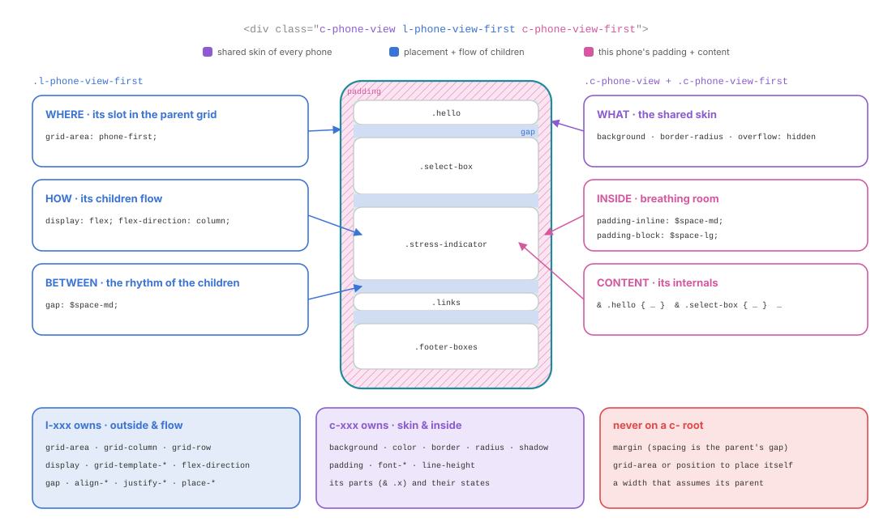
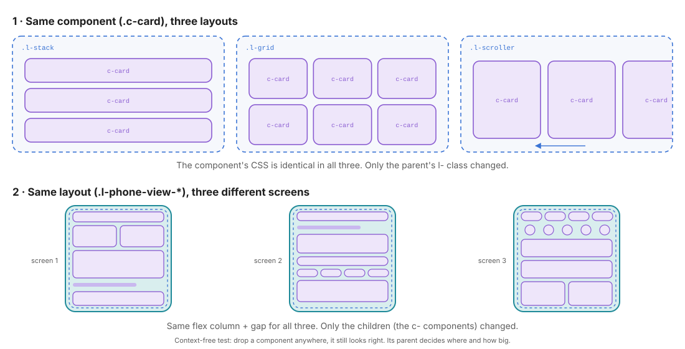

# 08 · Layout vs Components: who owns which property

> This is the heart of the method. Every CSS property answers either **"where and how do boxes flow?"** (layout, `l-`) or **"what does this box look like inside?"** (component, `c-`).
> Keep the two answers in **different classes**, and any component can move to any layout without a single line of CSS changing.

← [07 · Components](07-components.md) · [Index](README.md) · Next → [09 · Pages](09-pages.md)

---

## 1. The problem: coupled CSS

A classic stylesheet mixes both questions in one rule:

```scss
// ✗ coupled: this card only works in ONE place
.card {
  float: left;               // where it sits      → layout
  width: 33.333%;            // how big, in context → layout
  margin: 0 20px 20px 0;     // distance to siblings → layout
  padding: 1.5rem;           // breathing room      → component
  background: white;         // skin                → component
  border-radius: 12px;       // skin                → component
}
```

Put this card in a sidebar and it shrinks to a third of the sidebar. Put it in a horizontal scroller and the margins and float break the row. Every new context forces a new variant (`.card--sidebar`, `.card--full`…) and the CSS grows with every page.

The fix is not a new variant. It is to **split the rule in two**.

---

## 2. One element, three classes

Look at the root of each phone in [`index.html`](../index.html):

```html
<div class="c-phone-view l-phone-view-first c-phone-view-first">
```



| Class | Layer | Question it answers | Declarations |
| ----- | ----- | ------------------- | ------------ |
| `c-phone-view` | component | *What do **all** phones look like?* | `overflow: hidden; background-color: $color-bg-green; border-radius: $phone-radius;` |
| `l-phone-view-first` | layout | *Where is **this** phone, and how do its children flow?* | `grid-area: phone-first; display: flex; flex-direction: column; gap: $space-md;` |
| `c-phone-view-first` | component | *What is **inside** this phone?* | `padding-inline: $space-md; padding-block: $space-lg;` + `& .hello { … }`, `& .select-box { … }`… |

Each class can change **without touching the others**:

- Move the phone to another cell → edit the global wrapper's map, nothing else.
- Make the children flow in a grid → edit `l-phone-view-first` only.
- Repaint every phone → edit `c-phone-view` only.

---

## 3. The ownership table

| Property group | `l-` layout | `c-` component | Notes |
| -------------- | :---------: | :------------: | ----- |
| `grid-area`, `grid-column`, `grid-row`, `order` | ✓ | | Placement in the **parent's** map |
| `display: grid / flex` **for children** | ✓ | ✓ | `l-` for independent blocks, `c-` for its own parts |
| `grid-template-*`, `flex-direction`, `flex-wrap` | ✓ | ✓ | same |
| `gap`, `justify-*`, `align-*`, `place-*` | ✓ | ✓ | same |
| `padding` | | ✓ | The inside of a box belongs to the box |
| `margin` | | | Neither, by default: use the parent's `gap` (§4) |
| `background`, `border`, `border-radius`, `box-shadow`, `outline` | | ✓ | Skin |
| `color`, `font-*`, `line-height`, `text-*` | | ✓ | Typography |
| `:hover`, `:focus-*`, `:has()`, `[aria-*]` | | ✓ | States |
| `transition`, `animation`, `transform` | | ✓ | Motion |
| `width`, `max-width`, `flex`, `align-self`, `position`, `z-index`, `overflow`, `min-*: 0` | ⚠️ | ⚠️ | Gray zone (§6) |

---

## 4. The space rule: margin, padding, gap

Three properties create space. Each one has **exactly one owner**:

```text
 ┌──────────── parent (.l-phone-view-first) ─────────────┐
 │ ░░░░░░░░░░░░░░░░ padding (c-phone-view-first) ░░░░░░░ │
 │ ░ ┌─────────── .hello ────────────┐               ░ │
 │ ░ └────────────────────────────────┘               ░ │
 │ ░            ↕ gap: $space-md   ← owned by the l-  ░ │
 │ ░ ┌─────────── .select-box ────────┐               ░ │
 │ ░ └────────────────────────────────┘               ░ │
 │ ░            ↕ gap: $space-md                       ░ │
 │ ░ ┌─────────── .stress-indicator ──┐               ░ │
 │ ░ └────────────────────────────────┘               ░ │
 │ ░░░░░░░░░░░░░░░░░░░░░░░░░░░░░░░░░░░░░░░░░░░░░░░░░░░ │
 └───────────────────────────────────────────────────────┘
```

| Space | Property | Owner | Why |
| ----- | -------- | ----- | --- |
| **Inside** a box | `padding` | the component itself | It is part of how the box looks; it travels with it |
| **Between** siblings | `gap` | the parent (`l-` or the component that owns the parts) | Only the parent knows who the neighbours are |
| **Outside** a box | `margin` | nobody, by default | A margin on a component assumes something about its context |

> **No margin on a `c-` root.** A `.c-card { margin-bottom: 1rem; }` adds space after the last card of a list, doubles up with the parent's `gap`, and has to be cancelled everywhere it doesn't fit. The parent's `gap` does the same job, only *between* items, and adapts automatically when items are hidden or reordered.
>
> When a one-off outer space is really needed (an exception in a single place), use a utility (`.u-mt-0`, `.u-mt-lg`) in the HTML. That keeps the exception visible where it happens ([11](11-utils.md)).

---

## 5. Decoupling in practice: swap either side



**Same component, three layouts.** The `.c-card` CSS is identical; only the parent's `l-` class changes:

```html
<div class="l-stack">    <article class="c-card">…</article> × 3 </div>
<div class="l-auto-grid"><article class="c-card">…</article> × 6 </div>
<div class="l-scroller"> <article class="c-card">…</article> × 4 </div>
```

**Same layout, three contents.** The three phones share the same flex column + gap logic in `layout/_phone-view.scss`. Only the `c-phone-view-*` component inside changes.

### The context-free test

Before you call a component finished, mentally (or actually) drop it:

1. into an **empty page**, alone,
2. into a **narrow** column (300px),
3. into a **wide** column (900px),
4. into a **horizontal scroller**.

| If… | then the component is coupled to… | fix |
| --- | --------------------------------- | --- |
| it overlaps or leaves odd space around it | its siblings (outer margin) | remove the margin; let the parent's `gap` space it |
| it overflows the narrow column | a fixed width | let it fill: no `width`, or `max-width: 100%` |
| it lands in the wrong place | a `grid-area` / `position` on itself | move placement into the parent `l-` |
| it looks different | a parent selector (`.sidebar .card`) | turn the difference into a modifier |

---

## 6. The gray zone

Some properties sit on the border. Use **what the property refers to** to decide:

> **Rule**: if the value only makes sense **because of the parent** (its grid, its flex, its height, its stacking), it is layout. If it makes sense **for the box alone**, it is component.

| Property | Layout side when… | Component side when… | Project examples |
| -------- | ----------------- | -------------------- | ---------------- |
| `width`, `max-width` | it depends on the page: a reading column, a sidebar width | it is the box's **identity**: a 36px round button, a 1.25em icon | `circle($size-control-md)` → c; `minmax(0, $phone-width)` → l |
| `flex: 1`, `flex-shrink: 0` | it shares the **parent's** space with siblings | it sizes the component's **own** parts | `.c-app-bar-title { flex: 1 }` → c (part of the bar) |
| `align-self`, `justify-self` | it moves a standalone block inside the parent | it aligns a part inside the component's own grid | `.things-item-title { align-self: end }` → c |
| `position` | `sticky` header, `fixed` overlay: placed relative to the page | `relative` on the root to anchor its own `absolute` parts | `.hello-bell { position: relative }` + `.badge { position: absolute }` → c |
| `z-index` | page-level stacking (header over content, modal) via `$z-index-*` tokens | layering inside the component | none here; `isolation: isolate` in the reset keeps them local |
| `overflow` | the layout creates a scroll region | clipping its own rounded corners, or a component-owned scroller | `.c-phone-view { overflow: hidden }` → c (clips its radius) |
| `min-height: 0` / `min-width: 0` | the item lives in an `l-` flex/grid and must shrink | inside the component's own flex chain | `.things`, `.things-list`, `.search-input` → c |

### Standalone components vs internal blocks

In this project `flex: 1; min-height: 0` on `.things` is written **inside** `c-phone-view-second`, even though it reacts to the phone's flex column. That is consistent: `.things` is an **internal block** of the screen component ([07 §7](07-components.md#7-internal-blocks-vs-standalone-components)), so the screen owns how its own regions share space.

For a **standalone** `c-` component, never write these item properties on the component itself. Put them on the parent instead:

```scss
// ✓ the layout decides that the main area takes the remaining space
.l-dashboard {
  display: flex;
  flex-direction: column;

  > .l-dashboard-main { flex: 1; min-height: 0; }    // a layout slot, not the component
}
```

```html
<div class="l-dashboard">
  <header class="c-app-bar">…</header>
  <div class="l-dashboard-main"><section class="c-feed">…</section></div>
</div>
```

---

## 7. Same element or wrapper?

You can put an `l-` and a `c-` class on **the same element**, or wrap the component in an `l-` slot.

| Same element: `class="c-phone-view l-phone-view-first"` | Wrapper: `<div class="l-slot"><div class="c-card">` |
| ------------------------------------------------------- | ---------------------------------------------------- |
| Fewer DOM nodes | One extra `div` |
| Works as long as `l-` and `c-` **don't declare the same property** | Zero risk of conflict |
| What this project does for the phones | Better when one component is placed in many different layouts |

If both classes set the same property (say, both set `display`), the winner depends on **source order** (components come after layout in [`main.scss`](../src/scss/main.scss)). That is a hidden dependency. When you see it, either move the property to one side or use a wrapper.

> **Never** let an `l-` reach into a component: `.l-grid .c-card-title { … }` couples the layout to the card's internals. If the layout needs the card to look different, add a modifier to the card.

---

## 8. Refactoring coupled CSS: step by step

**Before**: one coupled rule.

```scss
.profile-card {
  grid-column: 2 / 4;
  margin-top: 24px;
  padding: 16px;
  background: $color-surface;
  border-radius: $radius-xl;
  display: flex;
  gap: 12px;
}
```

1. **Tag** each declaration **L** (depends on the parent) or **C** (belongs to the box): `grid-column` L, `margin-top` L, `padding` C, `background` C, `border-radius` C, `display: flex` + `gap` C (they arrange the card's **own** parts).
2. **Move** the L declarations to the parent's `l-` class, or to an `l-` class on the same element.
3. **Turn margins into `gap`** on the parent.
4. **Rename** the rest as a `c-` block.
5. **Run the context-free test** (§5).

**After**:

```scss
// layout/_profile.scss
.l-profile {
  display: grid;
  grid-template-columns: repeat(4, minmax(0, 1fr));
  row-gap: $space-lg;                  // was margin-top on the card

  &-card { grid-column: 2 / 4; }       // placement only
}

// components/_profile-card.scss
.c-profile-card {
  @include card($color-surface, $radius-xl);
  display: flex;
  gap: $space-sm;
  padding: $space-md;
}
```

```html
<div class="l-profile">
  <article class="l-profile-card c-profile-card">…</article>
</div>
```

---

## ✅ Checklist: layout vs components

- [ ] Every declaration can be labelled **L** or **C**; no class contains both (except the documented gray zones).
- [ ] No `c-` root has `grid-area`, outer `margin`, or a context-dependent width.
- [ ] Spacing between siblings is a `gap` on the parent.
- [ ] No `l-` selector reaches into a component's internals.
- [ ] When `l-` and `c-` share an element, they never declare the same property.
- [ ] Every standalone component passes the context-free test (empty page, narrow, wide, scroller).

Next → [09 · Pages](09-pages.md): what to do with rules that exist on one page only.
