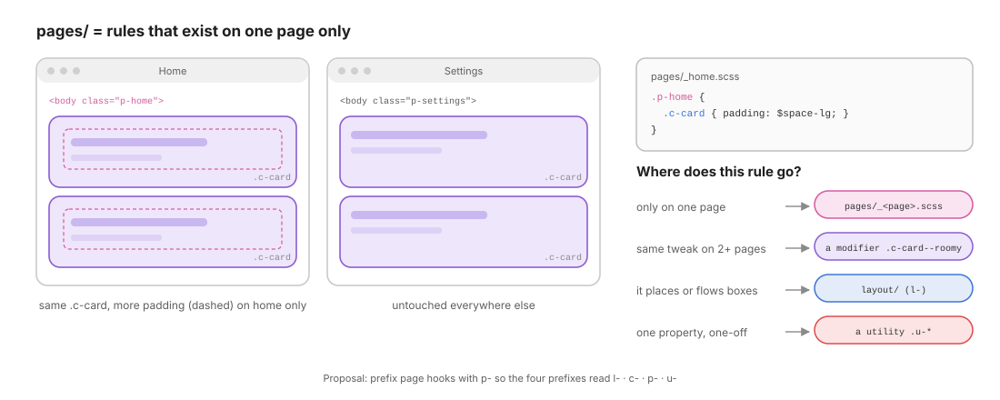

# 09 · Pages: rules that exist on one page only

> `pages/` holds the **exceptions**: a tweak that only makes sense on one page and nowhere else.
> It comes **after** components, so a page can adjust a component without touching its file.

← [08 · Layout vs Components](08-layout-vs-components.md) · [Index](README.md) · Next → [10 · Themes](10-themes.md)

```text
pages/
├── _index.scss   @forward "home";
└── _home.scss    @use "../abstracts" as *;   ← empty for now: the kata is a single page
```

---

## 1. Why a page layer?

Real projects have pages that are *almost* standard: the home page wants roomier cards, the checkout hides the footer links, the 404 centres everything. You have three bad options and one good one:

| Option | Problem |
| ------ | ------- |
| Edit the component | Every other page changes too |
| Add a parent selector inside the component file (`.home .c-card`) | The component now knows about pages: coupled |
| Inline styles or `!important` | Untraceable, impossible to override |
| ✓ **A page-scoped rule in `pages/_home.scss`** | Isolated, discoverable, deleted with the page |



---

## 2. The `p-` prefix (proposal)

The project currently has the folder but no page hook yet. To keep the prefix system consistent, give each page a scope class on its root element:

```html
<body class="p-home">
```

```scss
// pages/_home.scss
@use "../abstracts" as *;

.p-home {
  .c-card {
    padding: $space-lg;          // roomier cards on the home page only
  }
}
```

The prefixes then read like a sentence, left to right, from the most structural to the most specific:

| Prefix | Layer | Says |
| ------ | ----- | ---- |
| `l-` | layout | where boxes go and how they flow |
| `c-` | components | what a box looks like |
| `p-` | pages | which page we are on |
| `u-` | utils | a one-off override |

### Why it wins without `!important`

`.p-home .c-card` has a specificity of `(0,2,0)` against the component's `(0,1,0)`, **and** pages come later in [`main.scss`](../src/scss/main.scss). It wins on both criteria, so the override is predictable.

> ⚠️ Screen-level internal blocks are already `(0,2,0)` (`.c-phone-view-second .things`). To override one of them from a page you need `(0,3,0)`: `.p-home .c-phone-view-second .things`. That is still fine, but it shows why the page layer should stay **small**.

---

## 3. Where does this rule go?

```text
            A new rule appears…
                    │
     ┌──────────────┼──────────────────┬────────────────────┐
     ▼              ▼                  ▼                    ▼
 places or      changes a          same tweak on       one property,
 flows boxes?   component on       2+ pages?           one element,
     │          ONE page only?         │               one time?
     ▼              ▼                  ▼                    ▼
  layout/        pages/           a modifier           a utility
  (l-)           .p-<page> …      .c-card--roomy       .u-mt-lg
```

| Situation | Destination |
| --------- | ----------- |
| The page needs a different **grid map** for a shared layout | `pages/_<page>.scss`: `.p-home .l-main { grid-template-areas: …; }` |
| A component looks different on **one** page | `pages/_<page>.scss` |
| The same difference appears on a **second** page | promote it: a **modifier** in the component (`.c-card--roomy`) and delete both page rules |
| A single spacing fix on a single element | a **utility** in the HTML (`.u-mt-lg`) |

---

## 4. Adding a page

1. Create `pages/_settings.scss` starting with `@use "../abstracts" as *;`.
2. Add `@forward "settings";` to `pages/_index.scss`.
3. Put `class="p-settings"` on the page's root element (`<body>`, or the route's root in an SPA).
4. Write **only** rules scoped under `.p-settings`.

> **Smell**: a page file that keeps growing (say, beyond ~50 lines) is usually hiding a missing component or modifier. Promote the repeated patterns and keep the page layer a list of genuine exceptions.

---

## ✅ Checklist: pages

- [ ] Every rule in `pages/` is scoped under exactly one `.p-<page>` class.
- [ ] No component file mentions a page class.
- [ ] A tweak used on two pages has been promoted to a modifier.
- [ ] Page files are short; most of the styling still comes from components.

Next → [10 · Themes](10-themes.md): from frozen Sass tokens to runtime custom properties.
