# 10 · Themes: from frozen Sass tokens to runtime custom properties

> A theme changes **values**, never **structure**. The same component CSS renders light or dark because it reads **custom properties** that the theme layer swaps at runtime.

← [09 · Pages](09-pages.md) · [Index](README.md) · Next → [11 · Utils](11-utils.md)

```text
themes/
├── _index.scss     @forward "default";
└── _default.scss   // Theme overrides live here (dark mode, alt palettes, etc.).   ← empty for now
```

The kata ships a single light theme, written with Sass variables. This chapter is the step-by-step plan to add a dark theme **without JavaScript** when you need one.

---

## 1. Why Sass variables cannot theme

Sass variables exist **only at compile time**. After `vite build`, `$color-surface` has been replaced by `#ffffff` everywhere: the browser never sees the variable, so nothing can change it.

**CSS custom properties** (`--surface`) are the opposite: they live **in the browser**, they **inherit** down the DOM, and a selector or media query can redefine them at any moment.

| | Sass variable `$x` | Custom property `--x` |
| - | ------------------ | --------------------- |
| Exists | at compile time | at runtime, in the browser |
| Scope | Sass module / block | DOM subtree (inherits) |
| Can change with a media query or a selector | ✗ | ✓ |
| Works in Sass functions (`color.adjust`, `math.div`) | ✓ | ✗ |
| Best for | the **source of truth**, breakpoints, maths | anything that varies **at runtime**: themes, per-instance knobs |

The solution uses both: **Sass tokens define the values, custom properties carry them to the browser.**



---

## 2. Step by step

### Step 1: keep the tokens in `abstracts/`

Nothing changes: `$color-surface`, `$color-text`, `$color-ink`… stay the source of truth.

### Step 2: bridge tokens to custom properties

Name custom properties by **role**, not by colour (`--surface`, not `--white`), because in the dark theme the surface is no longer white.

```scss
// themes/_default.scss
@use "../abstracts" as *;

@mixin light-tokens {
  color-scheme: light;              // native controls & scrollbars follow the palette
  --surface: #{$color-surface};     // #{} is required: Sass doesn't evaluate custom property values
  --text: #{$color-text};
  --muted: #{$color-muted};
  --bg: #{$color-bg-green};
}

@mixin dark-tokens {
  color-scheme: dark;
  --surface: #{$color-ink};
  --text: #{$color-surface};
  --muted: #{$color-border};
  --bg: #{$color-teal-dark};
}

:root {
  @include light-tokens;
}
```

The two mixins keep each palette in **one** place, even though it is applied by several selectors in step 3. `color-scheme` travels with the palette, so form controls and scrollbars switch with the toggle too, not only with the OS setting.

### Step 3: switch at runtime

```scss
// themes/_default.scss (continued)

// a. Follow the OS setting
@media (prefers-color-scheme: dark) {
  :root { @include dark-tokens; }
}

// b. Let the user override it, with no JS: a checkbox holds the state, :has() reads it
:root:has(#theme-dark:checked) { @include dark-tokens; }
```

```html
<input class="u-sr-only" type="checkbox" id="theme-dark" />
<label for="theme-dark">Dark mode</label>
```

> ⚠️ A checkbox state does **not survive a reload** without JS (or a server). Treat the toggle as a session preference and keep `prefers-color-scheme` as the default. For a full *light / dark / auto* choice, use three radios and `:root:has(#theme-light:checked)` / `:root:has(#theme-dark:checked)`, applying the OS preference only when neither is checked.

### Step 4: components read the variables

```scss
// components/_phone-view.scss
.c-phone-view {
  overflow: hidden;
  background-color: var(--bg);           // was $color-bg-green
  border-radius: $phone-radius;          // structure stays a Sass token
}
```

Only **colours** (and maybe shadows) usually need to be custom properties. Spacing, radii and breakpoints stay Sass tokens: they don't change with the theme.

---

## 3. Theming a subtree with `[data-theme]`

Because custom properties **inherit**, you can re-theme **part** of the page by redefining them on any element:

```scss
[data-theme="dark"] { @include dark-tokens; }
```

```html
<div class="c-phone-view l-phone-view-third c-phone-view-third" data-theme="dark">
  <!-- only this phone is dark; its components are unchanged -->
</div>
```

Use a static `data-theme` attribute when the theme is decided by the markup (a dark promo banner, a server-rendered user preference); use `:has()` or `prefers-color-scheme` when it is decided at runtime.

---

## 4. The Sass-function caveat

Sass colour functions run at compile time, so they **cannot** read a custom property:

```scss
// ✗ compile error: color.adjust() expects a colour, not var(--surface)
background: color.adjust(var(--surface), $lightness: -5%);
```

Two ways out:

| Approach | Example | When |
| -------- | ------- | ---- |
| Compute in Sass, expose each variant as its own property | `--surface-hover: #{color.adjust($color-surface, $lightness: -5%)};` in **each** palette mixin | Few, known variants |
| Compute in the browser with `color-mix()` | `background: color-mix(in srgb, var(--surface) 90%, black);` | Variants derived from any theme value (supported by all evergreen browsers since 2023) |

---

## 5. Why themes come 8th

Themes are loaded **after** components and pages ([01](01-architecture.md#2-the-nine-layers-at-a-glance)). With the custom-property approach, order barely matters (a `:root` definition is read wherever the variable is used). But if a theme ever has to override a component **declaration** directly, being late in the cascade lets it win at equal specificity, without `!important`.

---

## ✅ Checklist: themes

- [ ] Sass tokens remain the single source of truth; custom properties are generated from them.
- [ ] Custom properties are named by **role** (`--surface`, `--text`), not by colour.
- [ ] Each palette is written once (a mixin) and applied by every selector that needs it.
- [ ] `color-scheme` is part of each palette, so native controls follow the theme.
- [ ] Dark mode respects `prefers-color-scheme` by default; any toggle is pure CSS.
- [ ] No Sass colour function receives a `var()`.

Next → [11 · Utils](11-utils.md): small classes that do one job and always win.
