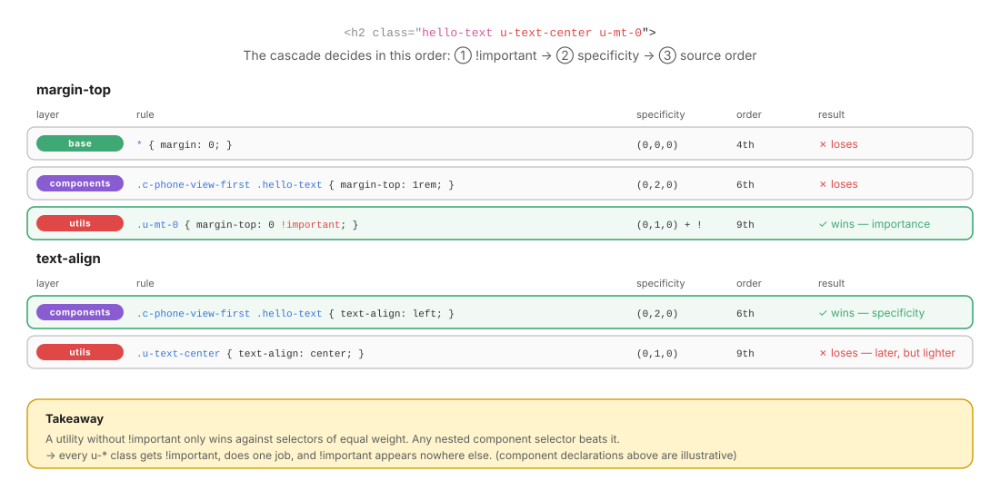

# 11 · Utils: one class, one job, always wins

> A utility is a **single-purpose override** you apply in the HTML: `.u-mt-0`, `.u-hidden`, `.u-sr-only`.
> It comes **last** in the cascade and carries `!important`, so it wins every time, by design.

← [10 · Themes](10-themes.md) · [Index](README.md) · Next → [12 · Recipe](12-recipe.md)

```text
utils/
├── _index.scss     @forward "helpers";
└── _helpers.scss   text alignment & colour, margin-top scale, visibility
```

---

## 1. What a utility is, and what it is not

| ✓ A utility | ✗ Not a utility |
| ----------- | --------------- |
| One property (or one inseparable group, like `sr-only`) | A bundle of styles that describes a thing → that's a component |
| A value taken from the token scale | A magic value (`.u-mt-13px`) |
| An **exception** applied in one place | The main way to style the page (that is a different methodology: utility-first CSS) |
| Safe anywhere, in any component | Something that depends on its context |

> **The 3-utility smell**: if an element needs three or more utilities to look right, it deserves a component or a modifier.

---

## 2. Why `!important` (and only here)

The cascade compares, in order: **① importance → ② specificity → ③ source order**. Being last in `main.scss` only helps at step ③. Most component selectors in this project are nested, so `(0,2,0)` or more, and they **beat** a plain `(0,1,0)` utility at step ② before order is even considered.



So every utility carries `!important`, and **`!important` appears nowhere else** in the code base. That makes it a reliable signal: if you see it, it is a utility.

---

## 3. The current utilities

[`utils/_helpers.scss`](../src/scss/utils/_helpers.scss):

| Class | Declaration | `!important` | Used in `index.html` |
| ----- | ----------- | :----------: | -------------------- |
| `.u-text-center` | `text-align: center` | ✗ | |
| `.u-text-right` | `text-align: right` | ✗ | |
| `.u-text-muted` | `color: $color-muted` | ✗ | |
| `.u-mt-0` … `.u-mt-xl` | `margin-top: 0 / $space-sm / md / lg / xl` | ✓ | |
| `.u-hidden` | `display: none` | ✓ | the SVG sprite `<svg class="u-hidden">` |
| `.u-sr-only` | `@include sr-only` (visually hidden, still read) | ✗ | search label, both `<legend>`s, every radio |

### Recommended fix

The three text utilities lose to any nested component selector (see the diagram). Align them with the rule:

```scss
// Text
.u-text-center { text-align: center !important; }
.u-text-right  { text-align: right !important; }
.u-text-muted  { color: $color-muted !important; }
```

`.u-sr-only` is a lighter case: no component currently sets `position` or `width` on an element that carries it, so it works. If that ever happens, the hidden element would reappear. Adding `!important` inside the class (not the mixin) would make it bullet-proof:

```scss
.u-sr-only {
  position: absolute !important;
  width: 1px !important;
  height: 1px !important;
  …
}
```

### `.u-hidden` vs `.u-sr-only` vs `hidden`

| Technique | Visible | Read by screen readers | Focusable | Use for |
| --------- | :-----: | :--------------------: | :-------: | ------- |
| `.u-hidden` / `display: none` | ✗ | ✗ | ✗ | Things nobody should perceive (the SVG sprite) |
| `hidden` attribute | ✗ | ✗ | ✗ | Same, in pure HTML; but any `display` rule overrides it, so prefer `.u-hidden` when CSS sets `display` |
| `.u-sr-only` | ✗ | ✓ | ✓ | Labels, legends, and inputs whose visual is drawn by another element |
| `aria-hidden="true"` | ✓ | ✗ | ✓ ⚠️ | Decorative glyphs (never on focusable elements) |

---

## 4. Writing utilities

### Generate them from the tokens

Hand-written lists drift from the token scale. A Sass `@each` keeps them in sync:

```scss
@use "../abstracts" as *;

$-margins: (0: 0, sm: $space-sm, md: $space-md, lg: $space-lg, xl: $space-xl);

@each $name, $value in $-margins {
  .u-mt-#{$name} { margin-top: $value !important; }
}
```

This compiles to exactly the five classes the project writes by hand today.

### Responsive utilities, only if needed

```scss
@use "../responsive" as *;

.u-hidden-below-tablet {
  @include desktop-first(tablet-portrait) {
    display: none !important;
  }
}
```

Add them one by one, when a real need appears. Generating every utility at every breakpoint creates hundreds of classes nobody uses.

### Naming

`u-` + **property shorthand** + **token name**: `u-mt-lg` (margin-top, large), `u-text-center`. Never name a utility after where it is used (`.u-home-title-fix`): that is a page rule ([09](09-pages.md)).

---

## ✅ Checklist: utils

- [ ] Every utility does one job and uses a token value.
- [ ] Every utility carries `!important`, and no other layer uses it.
- [ ] Utilities are applied in the HTML, never `@extend`ed or `@include`d in Sass.
- [ ] No element needs more than two utilities; otherwise it got a component or a modifier.
- [ ] Hidden content uses the right technique (`.u-hidden`, `.u-sr-only`, `aria-hidden`).

Next → [12 · Recipe](12-recipe.md): the whole method, from mockup to SCSS, in ten steps.
