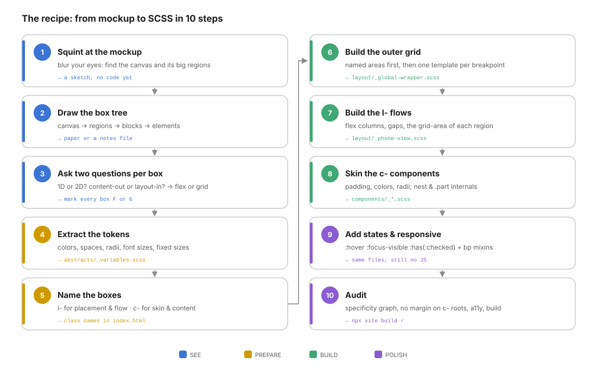
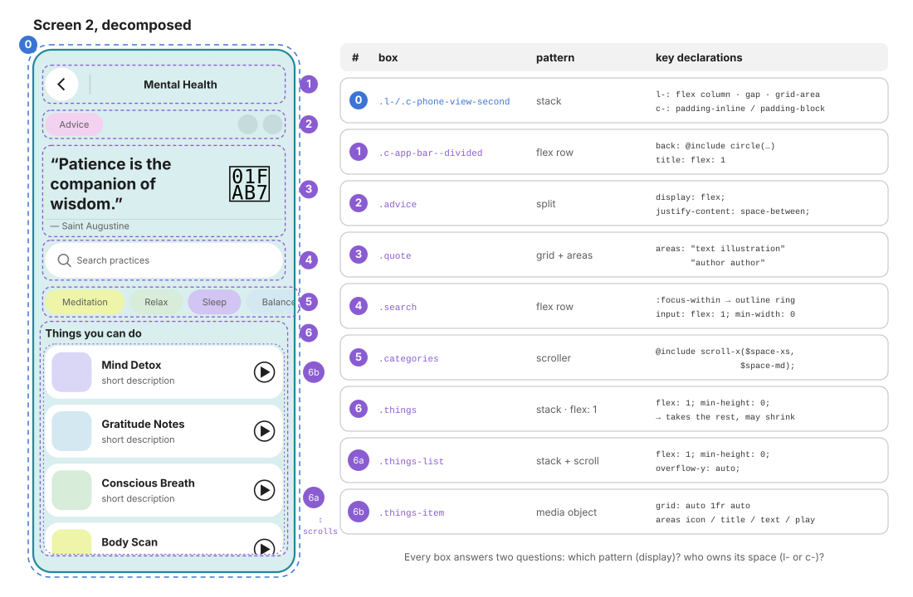

# 12 · The recipe: from mockup to SCSS in ten steps

> Everything from the previous chapters, as one repeatable procedure.
> Follow it in order, on any mockup, and the CSS will come out decoupled, predictable and easy to change.

← [11 · Utils](11-utils.md) · [Index](README.md)



| Phase | Steps | You produce | Code written |
| ----- | ----- | ----------- | ------------ |
| **SEE** | 1–3 | a sketch, a box tree, an F/G mark on every box | none |
| **PREPARE** | 4–5 | tokens and class names | `_variables.scss`, `index.html` |
| **BUILD** | 6–8 | the canvas grid, the region flows, the components | `layout/`, `components/` |
| **POLISH** | 9–10 | states, breakpoints, an audit | same files |

> The first three steps write **no code**. Most CSS problems are decomposition problems discovered too late. Ten minutes with a pencil saves hours of overrides.

---

## Step 1 · Squint at the mockup

**Goal**: find the **canvas** and its big **regions**.

- Blur your eyes (or zoom the mockup out to 25%). Only large masses of colour and whitespace remain.
- Draw a rectangle around each mass. Those are the regions. Note how they relate: side by side? stacked? overlapping?
- Note the **fixed** sizes the design imposes (a 350×700 phone, a 1200px container, a 64px header).

**Output**: a rough sketch with 2–6 rectangles. → [00 §2](00-mental-model.md#2-the-squint-test)

---

## Step 2 · Draw the box tree

**Goal**: every visible rectangle becomes a node: **canvas → regions → blocks → elements**.

- Unblur progressively: each region splits into blocks, each block into elements.
- Write it as an indented list. Every node will become **one HTML element**.
- Mark repeated blocks (×3 cards, ×7 dates): they will become one class used several times.

```text
canvas    .l-global-wrapper
└─ region   phone 2
   ├─ block    app bar          ← also in phone 3 → standalone component
   ├─ block    advice
   ├─ block    quote
   ├─ block    search
   ├─ block    categories       ×4 pills
   └─ block    things
      └─ block   item           ×3, scrolls
         └─ elements  icon · title · text · play
```

**Output**: the tree on paper or in a notes file. → [00 §4](00-mental-model.md#4-the-box-tree)

---

## Step 3 · Ask two questions per box

For every node that has children:

1. **One dimension or two?** Items in a line → **flex**. Rows *and* columns that must align → **grid**.
2. **Content-out or layout-in?** Children decide their size and the container distributes leftovers → **flex**. The container draws tracks and drops children into them → **grid**.

Then pick the **pattern** ([06 §8](06-layout.md#8-the-eight-layout-patterns)): stack, cluster, split, center, media object, scroller, auto-grid, overlay.

**Output**: an **F** or **G** (and a pattern name) next to every parent in the tree. → [00 §6](00-mental-model.md#6-the-decision-tree)

---

## Step 4 · Extract the tokens

**Goal**: no raw value will ever appear in a component.

- Pick every **colour** on the mockup; give each a **role** name (`$color-surface`) or a palette name (`$color-lavender`).
- Measure **spacings** and snap them to a scale (`2xs … 2xl`). Five to seven steps are enough.
- Same for **radii**, **font sizes**, **control sizes** and the fixed sizes from step 1.

**Output**: [`abstracts/_variables.scss`](../src/scss/abstracts/_variables.scss). → [02 §2](02-abstracts.md#2-tokens-_variablesscss)

---

## Step 5 · Name the boxes

**Goal**: write the HTML skeleton with **all** the classes before any CSS.

- Canvas and regions get an `l-` class (where + flow). If they also have a look, add a `c-` class on the same element.
- Blocks used in several places get a standalone `c-` name. Blocks used once can stay unprefixed and be scoped inside their region's component.
- Elements: `block-part`. Variants: `block--variant`. States: real HTML (`checked`, `aria-current`), not classes.
- Use semantic elements: `header`, `figure`/`blockquote`, `form role="search"`, `fieldset`/`legend`, `ul role="list"`, `button`.

**Output**: [`index.html`](../index.html) with every class in place. → [07 §2](07-components.md#2-anatomy-block-element-modifier-state)

---

## Step 6 · Build the outer grid

**Goal**: the canvas map, at every breakpoint.

- Write `grid-template-columns`, `grid-template-rows` and `grid-template-areas` on the canvas `l-` class.
- Name the areas semantically; each region declares `grid-area: <name>` and nothing else about its position.
- Then redraw the **map only** for each breakpoint with the [responsive mixins](03-responsive.md).

**Output**: [`layout/_global-wrapper.scss`](../src/scss/layout/_global-wrapper.scss). → [06 §4](06-layout.md#4-named-areas-draw-the-map-in-ascii)

---

## Step 7 · Build the `l-` flows

**Goal**: each region places its blocks.

- `display: flex; flex-direction: column; gap: …` for a stack; a grid if the region is 2D.
- Spacing between blocks is the region's `gap`. No margins.
- Still no colour, font or padding.

**Output**: [`layout/_phone-view.scss`](../src/scss/layout/_phone-view.scss). At this point, outline everything (`* { outline: 1px solid red }`, temporarily) and check that the boxes match the sketch from step 1.

---

## Step 8 · Skin the `c-` components

**Goal**: every block looks right.

- One partial per standalone component; screen components nest their internal blocks with `& .block`.
- Follow the [file skeleton](07-components.md#4-the-file-skeleton): mixins → arrangement → box → skin → typography → motion → states → elements → modifiers → media.
- Padding is the component's; the internal grid or flex of its parts is the component's.
- Reach for the [mixins](02-abstracts.md#4-the-mixin-catalog-_mixinsscss) before writing a pattern twice.

**Output**: `components/_*.scss`. → [07](07-components.md), [08](08-layout-vs-components.md)

---

## Step 9 · Add states and responsive refinements

**Goal**: everything interactive reacts; everything fits at every width.

- `:hover`, `:focus-visible` (via `focus-ring`), `:active`, `:has(:checked)`, `:focus-within`, `[aria-current]`.
- `@include reduced-motion { transition: none; }` at the end of every animated component.
- Test at 320px, at the breakpoint seams, and at the widest size. Fix with intrinsic techniques first, breakpoints second.

**Output**: the same files, still no JS. → [07 §5](07-components.md#5-states-without-javascript), [03](03-responsive.md)

---

## Step 10 · Audit

| Check | How |
| ----- | --- |
| Build passes | `npx vite build` |
| Specificity stays low and only rises at the end | read the compiled CSS; look for long selectors ([01 §4](01-architecture.md#4-specificity-only-goes-up)) |
| No `margin` on a `c-` root, no `grid-area` in a component | `grep -n "margin" src/scss/components` and review each hit |
| No raw colours in components | `grep -nE "#[0-9a-fA-F]{3,6}\b" src/scss/components` |
| `!important` only in utils | `grep -rn "!important" src/scss --include=*.scss` |
| Keyboard | Tab through the page: every control shows a ring, the order is logical |
| Screen reader names | every icon button has `aria-label`; decorative glyphs are `aria-hidden` |
| Reduced motion | enable it in the OS; transitions stop |

---

## Case study: screen 2, end to end



| # | Box | Pattern | Owner | Key declarations |
| - | --- | ------- | ----- | ---------------- |
| 0 | phone 2 | stack | `l-phone-view-second` (flow) + `c-phone-view-second` (padding) | `flex-direction: column; gap: $space-md` · `padding-inline: $space-md; padding-block: $space-lg` |
| 1 | app bar | flex row | `c-app-bar c-app-bar--divided` | back: `circle(…)`; title: `flex: 1` |
| 2 | advice | split | internal block `.advice` | `display: flex; justify-content: space-between` |
| 3 | quote | grid + areas | internal block `.quote` | `"text illustration" "author author"` |
| 4 | search | flex row | internal block `.search` | `:focus-within` ring; input `flex: 1; min-width: 0` |
| 5 | categories | scroller | internal block `.categories` | `@include scroll-x($space-xs, $space-md)` |
| 6 | things | stack, fills the rest | internal block `.things` | `flex: 1; min-height: 0` |
| 6a | things list | stack + vertical scroll | `.things-list` | `flex: 1; min-height: 0; overflow-y: auto` |
| 6b | things item | media object | `.things-item` (+ `--detox` …) | `grid-template-columns: auto 1fr auto`; `flex-shrink: 0` |

The resulting component file has exactly the shape of the tree:

```scss
// components/_phone-view-second.scss: skeleton only
@use "../abstracts" as *;

.c-phone-view-second {
  padding-inline: $space-md;
  padding-block: $space-lg;

  & .advice     { display: flex; justify-content: space-between; align-items: center; … }
  & .quote      { display: grid; grid-template-columns: 1fr auto; grid-template-areas: …; … }
  & .search     { display: flex; align-items: center; …  &:focus-within { … }  &-input { flex: 1; min-width: 0; } }
  & .categories { @include scroll-x($space-xs, $space-md);  &-item { @include pill; … } }
  & .things {
    display: flex; flex-direction: column; flex: 1; min-height: 0;
    &-list { flex: 1; min-height: 0; overflow-y: auto; … }
    &-item { display: grid; grid-template-columns: auto 1fr auto; flex-shrink: 0; … }
  }

  @include reduced-motion { … }
}
```

Box 1 is **not** in this file: `.c-app-bar` is shared with screen 3, so it was promoted to its own partial ([07 §7](07-components.md#7-internal-blocks-vs-standalone-components)).

---

## File templates

### A layout partial

```scss
// layout/_<name>.scss
@use "../abstracts" as *;
@use "../responsive" as *;

.l-<name> {
  display: grid;
  grid-template-columns: …;
  grid-template-areas:
    "…"
    "…";
  gap: $space-md;

  @include desktop-first(tablet-portrait) {
    grid-template-columns: …;
    grid-template-areas: "…";
  }

  &-<slot> { grid-area: <slot>; }
}
```

### A component partial

```scss
// components/_<name>.scss
@use "../abstracts" as *;

$-<private-constant>: …;

.c-<name> {
  @include card($color-surface, $radius-xl);
  display: flex;
  gap: $space-sm;
  padding: $space-md;
  font-size: $font-size-sm;
  transition: background-color $transition-base;

  &:hover { … }

  &-<element> { … }

  &--<modifier> { … }

  @include reduced-motion { transition: none; }
}
```

### A page partial

```scss
// pages/_<page>.scss
@use "../abstracts" as *;

.p-<page> {
  .c-<name> { … }    // only what differs on this page
}
```

### Registering a partial

```scss
// <folder>/_index.scss
@forward "<name>";    // keep the order: shared pieces before the files that use them
```

---

## Troubleshooting

| Symptom | Likely cause | Fix | Chapter |
| ------- | ------------ | --- | ------- |
| A list pushes past the bottom of its container instead of scrolling | `flex: 1` without `min-height: 0` somewhere in the chain | `min-height: 0` on every flex item between the fixed ancestor and the scroller | [06 §6](06-layout.md#6-flex-sizing-flex-1-and-the-min-size-trap) |
| An input or long text overflows a flex row | `min-width: auto` | `min-width: 0` on the item | [06 §6](06-layout.md#6-flex-sizing-flex-1-and-the-min-size-trap) |
| "Equal" grid columns are not equal | `1fr` = `minmax(auto, 1fr)` | `minmax(0, 1fr)` | [06 §3](06-layout.md#3-sizing-tracks) |
| A whole `grid-template-areas` is ignored | strings with different cell counts, or a non-rectangular area | count the cells; make every area a rectangle | [06 §4](06-layout.md#4-named-areas-draw-the-map-in-ascii) |
| A modifier's element style never applies | `&--mod &-el` repeated the parent selector | write the element class in full: `&--mod .block-el` | [07 §3](07-components.md#3-how--compiles) |
| Text inside a component is grey instead of the component's colour | base's `p { color: $color-muted }` beats inheritance | `& p { color: inherit; }` | [05 §5](05-base.md#5-inheritance-what-flows-down-and-the-p-trap) |
| A utility class has no effect | no `!important`; a nested component selector is heavier | add `!important` to the utility | [11 §2](11-utils.md#2-why-important-and-only-here) |
| Double space between two cards | margin on the component **and** gap on the parent | remove the margin | [08 §4](08-layout-vs-components.md#4-the-space-rule-margin-padding-gap) |
| A component looks right in one place, broken in another | it positions or sizes itself for one context | move placement and width to the parent `l-` | [08 §5](08-layout-vs-components.md#5-decoupling-in-practice-swap-either-side) |
| Two queries both apply at exactly 768px | `min-width: 768px` and `max-width: 768px` | use the mixins (`- 0.02px`) | [03 §3](03-responsive.md#3-mobile-first-vs-desktop-first) |
| Content shifts or overflows when a `fieldset` is in a flex/grid | fieldset's `min-inline-size: min-content` | the reset's rule 10, or `min-width: 0` | [05 §2](05-base.md#2-the-reset-rule-by-rule) |
| A gap appears under an image | inline media sit on the text baseline | `display: block` (reset rule 5) | [05 §2](05-base.md#2-the-reset-rule-by-rule) |
| `Undefined variable` / `Undefined mixin` in a partial | the partial doesn't `@use` the abstracts | add `@use "../abstracts" as *;` at the top | [01 §5](01-architecture.md#5-the-sass-module-system) |
| A hidden radio can't be reached with the keyboard | it was hidden with `display: none` | use `.u-sr-only` and show focus on the label with `:has(:focus-visible)` | [07 §5](07-components.md#5-states-without-javascript) |

---

## ✅ The master checklist

**See**
- [ ] I squinted, sketched the regions and noted the fixed sizes.
- [ ] Every rectangle is in the box tree; repeated blocks are marked.
- [ ] Every parent has F or G and a pattern name.

**Prepare**
- [ ] Every colour, space, radius and size is a token; components contain no raw values.
- [ ] The HTML is semantic, and every element has its classes (`l-` / `c-` / elements / modifiers).

**Build**
- [ ] The canvas uses named grid areas; regions only declare `grid-area`.
- [ ] `l-` classes contain flow and placement only; `c-` classes contain skin, padding and parts.
- [ ] Spacing between siblings is always `gap`; no `c-` root has an outer margin.
- [ ] Nesting is ≤ 3 levels; a block used twice is a standalone component.

**Polish**
- [ ] All interactive elements have hover, focus-visible and accessible names; states come from the DOM.
- [ ] Reduced motion is respected.
- [ ] The layout works at 320px, at every seam and at the widest size; breakpoints only redraw maps.
- [ ] `!important` only exists in utils; the build passes.

← Back to the [Index](README.md)
