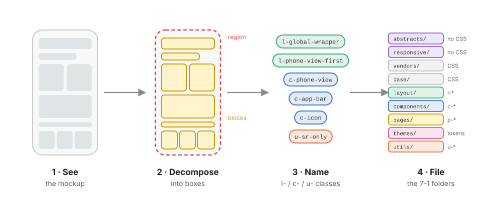

# The SCSS UI Bible

> **Every interface is a tree of boxes.**
> **Grid** draws the map, **Flex** lines things up.
> **`l-`** classes decide *where* a box goes and *how* its children flow,
> **`c-`** classes decide *what* it looks like and *what is inside*,
> **`u-`** classes fix one property, once, and always win.



This folder is a **recipe book**. It was written while building the *payment-app* kata: a three-screen mental-health mockup coded in pure SCSS, without a single line of JavaScript. Every rule, diagram and pitfall comes from real code in [`src/scss/`](../src/scss/), but none of it is specific to this project. Use it to build **any** Sass interface.

---

## Table of contents

| #  | Chapter | You will learn | Folder it explains |
| -- | ------- | -------------- | ------------------ |
| 00 | [The mental model](00-mental-model.md) | Seeing boxes, the 4 decomposition levels, the box tree, Grid vs Flex | *(a way of thinking)* |
| 01 | [Architecture](01-architecture.md) | 7-1 pattern × ITCSS, import order, `@use` / `@forward`, prefixes | [`src/scss/`](../src/scss/) |
| 02 | [Abstracts](02-abstracts.md) | Tokens, functions, mixins, and why they output 0 bytes | [`abstracts/`](../src/scss/abstracts/) |
| 03 | [Responsive](03-responsive.md) | Breakpoint scale, mobile-first vs desktop-first, redrawing the map | [`responsive/`](../src/scss/responsive/) |
| 04 | [Vendors](04-vendors.md) | Loading third-party CSS without fighting it | [`vendors/`](../src/scss/vendors/) |
| 05 | [Base](05-base.md) | Reset, typography, inheritance traps | [`base/`](../src/scss/base/) |
| 06 | [Layout](06-layout.md) | Grid and Flex in depth, layout patterns, the `l-` contract | [`layout/`](../src/scss/layout/) |
| 07 | [Components](07-components.md) | Block / element / modifier / state, Sass `&`, no-JS states | [`components/`](../src/scss/components/) |
| 08 | [Layout vs Components](08-layout-vs-components.md) | **The decoupling contract** between `l-` and `c-` | `layout/` + `components/` |
| 09 | [Pages](09-pages.md) | Page-scoped overrides and the `p-` hook | [`pages/`](../src/scss/pages/) |
| 10 | [Themes](10-themes.md) | Sass tokens → CSS custom properties → dark mode with no JS | [`themes/`](../src/scss/themes/) |
| 11 | [Utils](11-utils.md) | Single-purpose `u-` classes and `!important` done right | [`utils/`](../src/scss/utils/) |
| 12 | [The recipe](12-recipe.md) | 10 steps from mockup to SCSS + a full case study | *(everything together)* |

### Reading order

```text
First time?        00 → 01 → 06 → 07 → 08 → 12        (the core: think, organise, lay out, skin, decouple, apply)
Then, as needed:   02 03 04 05 09 10 11                 (one chapter per folder, read when you touch that folder)
Building a UI now: 12 → follow the steps, jump to the chapter each step links to
```

---

## The folder map

```text
src/scss/
├── main.scss              ← the only entry point: imports the 9 layers in ITCSS order
├── abstracts/             1 · Settings + Tools  → tokens, functions, mixins      (no CSS output)
├── responsive/            2 · Tools             → breakpoint mixins              (no CSS output)
├── vendors/               3 · Generic           → third-party CSS, untouched
├── base/                  4 · Generic+Elements  → reset, typography              (element selectors)
├── layout/                5 · Objects           → .l-*  placement + flow         (no skin)
├── components/            6 · Components        → .c-*  skin + internals         (no placement)
├── pages/                 7 · Page scope        → .p-*  one-page overrides
├── themes/                8 · Themes            → palettes, custom properties
└── utils/                 9 · Utilities         → .u-*  one job, !important      (always last)
```

The order is **not** alphabetical. It goes from *generic and far-reaching* to *specific and narrow*, so specificity only ever goes **up** as you read the compiled file. See [01 · Architecture](01-architecture.md).

---

## The three prefixes (plus one)

| Prefix | Means | Owns | Never does | Example |
| ------ | ----- | ---- | ---------- | ------- |
| `l-` | **layout** (ITCSS *Object*) | its slot in the parent (`grid-area`) + how its children flow (`display`, `gap`, direction, alignment) | colors, borders, fonts, padding | [`.l-global-wrapper`](../src/scss/layout/_global-wrapper.scss) |
| `c-` | **component** | its skin (background, radius, shadow, type), its padding, its internal parts and their states | positioning itself, outer margin | [`.c-app-bar`](../src/scss/components/_app-bar.scss) |
| `u-` | **utility** | exactly one declaration, with `!important` | anything else | [`.u-sr-only`](../src/scss/utils/_helpers.scss) |
| `p-` | **page** *(proposed)* | a hook on `<body>` for overrides that exist on one page only | becoming a dumping ground | `.p-home .c-card { … }` |

One HTML element can carry several prefixes. That is the point: each class answers a different question.

```html
<div class="c-phone-view  l-phone-view-first  c-phone-view-first">
<!--        └ shared skin   └ where + flow      └ this screen's padding + content -->
```

---

## The 10 golden rules

1. **Decompose before you type.** Draw the box tree (canvas → regions → blocks → elements) on paper first. Code is the *last* step. → [00](00-mental-model.md)
2. **Grid for the map, Flex for the line.** If the parent decides sizes in 2D, use Grid. If the children decide their sizes along one axis, use Flex. → [06](06-layout.md)
3. **`l-` places, `c-` paints.** A layout class never sets a color; a component never sets its own `grid-area` or outer `margin`. → [08](08-layout-vs-components.md)
4. **Margin is outside, padding is inside, gap is between.** Space between siblings belongs to the parent's `gap`, never to a child's margin.
5. **No magic numbers.** Every color, space, radius and size comes from a token in [`_variables.scss`](../src/scss/abstracts/_variables.scss). → [02](02-abstracts.md)
6. **Specificity only goes up.** Respect the import order, nest at most 3 levels, no IDs, `!important` only in `utils/`. → [01](01-architecture.md)
7. **Responsive = redraw the map.** Breakpoints change the *layout* (`grid-template-*`), not the components. → [03](03-responsive.md)
8. **The DOM holds the state, CSS reacts.** `:hover`, `:focus-visible`, `[aria-current]`, `:has(:checked)`, `:focus-within`, no JS needed. → [07](07-components.md)
9. **`flex: 1` needs `min-height: 0`** (or `min-width: 0`) when the content must be allowed to shrink and scroll. → [06](06-layout.md#6-flex-sizing-flex-1-and-the-min-size-trap)
10. **One `&` per selector.** To style an element of a modifier, spell the element class out in full. → [07](07-components.md#3-how--compiles)

---

## Glossary

| Term | Meaning |
| ---- | ------- |
| **Box** | Any element. Everything on screen is a rectangle with a margin, border, padding and content. |
| **Canvas** | The outermost box: the page or app shell (`.l-global-wrapper`). |
| **Region** | A big zone of the canvas (a phone screen, a sidebar, a header). |
| **Block** | A self-contained unit inside a region (`.quote`, `.search`, `.things-item`). |
| **Element** | A part that only makes sense inside its block (`.things-item-icon`). |
| **Modifier** | A variant of a block, written next to it (`.things-item--detox`). |
| **State** | A temporary condition read from the DOM (`:hover`, `:checked`, `[aria-current]`). |
| **Token** | A named design decision (`$space-md`, `$color-ink`). |
| **Track** | A grid column or row. |
| **Area** | A named rectangle of grid cells (`phone-first`). |
| **Main / cross axis** | Flex's direction of flow / the perpendicular direction. |
| **Specificity** | The weight of a selector, written `(ids, classes, elements)`. |
| **Cascade layer (ITCSS)** | One of the 9 folders, imported in increasing order of specificity. |
| **Partial** | A Sass file starting with `_`, loaded with `@use` / `@forward`, never compiled alone. |

---

## About the diagrams

All diagrams live in [`assets/`](assets/) as plain SVG files, so they render on GitHub, in VS Code's preview and in any browser, and they stay sharp at any zoom. The colour code is the same everywhere:

| Colour | Always means |
| ------ | ------------ |
| 🟦 Blue | layout, `l-`, grid lines, the parent |
| 🟪 Purple | component, `c-`, skin |
| 🩷 Pink | padding, page-specific |
| 🟩 Green | elements, success, "this works" |
| 🟧 Orange | modifiers |
| 🟥 Red | utilities, pitfalls, "this breaks" |
| 🟨 Yellow | tokens, notes, takeaways |
